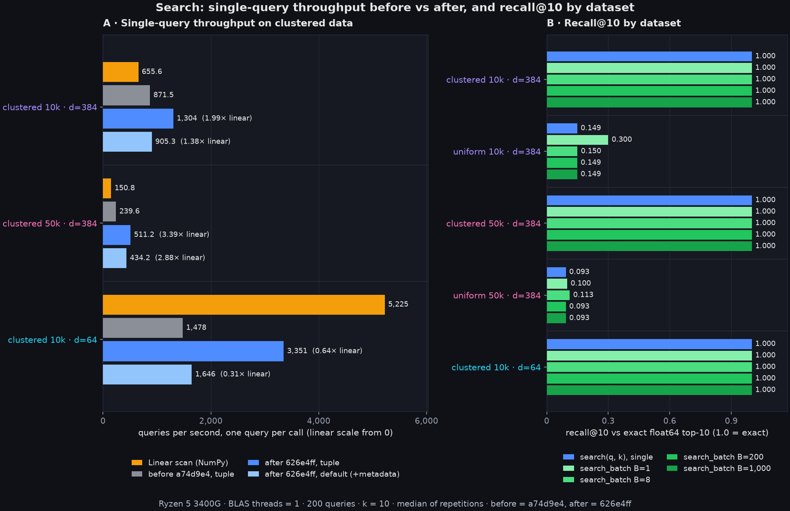

<p align="center">
  
  
  
  
  
</p>

<h1 align="center">M2M Vector Search</h1>

<p align="center">
  <strong>Machine-to-Memory</strong> &mdash; a vector search engine where every vector is a
  Gaussian splat, with energy-based uncertainty, fail-closed metadata filters and optional
  CUDA/Vulkan backends. Pure Python and NumPy at the core.
</p>

<p align="center">
  <a href="#quick-start">Quick Start</a> &bull;
  <a href="#features">Features</a> &bull;
  <a href="#metadata-filters">Filters</a> &bull;
  <a href="#persistence">Persistence</a> &bull;
  <a href="#rest-api">REST API</a> &bull;
  <a href="#architecture">Architecture</a> &bull;
  <a href="#security">Security</a> &bull;
  <a href="#benchmarks">Benchmarks</a> &bull;
  <a href="#development">Development</a>
</p>

---

**Status of 2.4.0.** This version is the outcome of a full audit of the code, its claims and
its benchmarks (2026-11): 114 commits (merges excluded) fix search semantics, filters, the write path,
persistence and the HTTP API, and the documentation was rewritten to describe what the code
does. It is on PyPI as `m2m-vector-search` (the publish workflow uploads every GitHub
Release). What changed, with the audit id of every fix, is in the [CHANGELOG](CHANGELOG.md).

---

## Features

- **Gaussian splats** — each vector is stored as a Gaussian `αᵢ · exp(−κᵢ · ‖x − μᵢ‖²)`: center `μ`, concentration `κ` and amplitude `α` per document.
- **Hierarchical routing (HRM2)** — queries are routed to `n_probe` coarse clusters instead of scanning the index; `HRM2Config` and a gate of modulus (`gate_select_k`) choose the number of clusters.
- **One score, everywhere** — `DocResult.score` is the cosine similarity in `[-1, 1]` on every path (single, batch, filtered, LSH); `alpha` and `distance` are separate fields.
- **Energy and confidence per result** — `energy` is the energy of the query under the result's splat and `confidence = sigmoid(−energy)`; out-of-distribution queries hit a visible cap.
- **Fail-closed metadata filters** — `$eq/$ne/$in/$nin/$gt/$gte/$lt/$lte` or a callable, applied before the top-k in `search()`, `search_batch_filtered()` and `delete(filter=...)`, and **exact** in IVF mode (recall@10 = 1.0 on the benchmark filters); unknown operators raise instead of being ignored.
- **Persistence that round-trips** — `storage_path` restores splats, index and soft-deletes on reopen; `save(path)` writes a self-contained snapshot; optional HMAC signing with `M2M_HMAC_SECRET`.
- **HTTP API** — FastAPI service (`python -m m2m`) with optional API key, opt-in rate limit, body-size limit and explicit status codes.
- **Backends** — CPU by default; CUDA (`torch`) and Vulkan (compute shaders) as optional extras. The engine reports the backend actually in use (`db.engine.backend`). There is no multi-GPU support.
- **LangChain integration** — a `VectorStore` (`M2MVectorStore`); the retriever is `as_retriever()`.
- **Learning from feedback** — `db.feedback(query, relevant_ids=..., irrelevant_ids=...)` applies Hebbian updates of `α`, `κ`, `μ` by document id; `AdvancedVectorDB.maybe_consolidate()` prunes when the SOC index is SUPERCRITICAL (see [below](#learning-from-feedback)).
- **Edge/cluster mode** — a coordinator fans queries out to edge nodes and merges the results (`docs/cluster.md`).

---

## Quick Start

### Install

```bash
pip install "m2m-vector-search"
# latest development state, from source:
# pip install "git+https://github.com/schwabauerbriantomas-gif/m2m-vector-search.git"
```

Extras: `[api]` for the HTTP service, `[langchain]`, `[embeddings]` (torch + sentence-transformers, also needed for CUDA), `[vulkan]`, `[dev]` for development. `pip install -e ".[all]"` pulls everything, including torch (> 1 GB).

### Minimal example

```python
import numpy as np
from m2m import SimpleVectorDB

rng = np.random.default_rng(0)
db = SimpleVectorDB(latent_dim=128)

vectors = rng.standard_normal((1000, 128)).astype(np.float32)
db.add(vectors=vectors, ids=[f"doc_{i}" for i in range(1000)])

query = rng.standard_normal(128).astype(np.float32)
results = db.search(query, k=10, include_metadata=True)

for r in results:
    print(f"  {r.id}: score={r.score:.4f}")
```

```text
  doc_673: score=0.3024
  doc_818: score=0.2572
  doc_967: score=0.2439
  doc_374: score=0.2146
  doc_347: score=0.2122
  doc_809: score=0.2082
  doc_774: score=0.2026
  doc_29: score=0.2002
  doc_926: score=0.1994
  doc_458: score=0.1963
```

`score` is the cosine similarity between the (normalized) query and the stored vector. On
random data even the nearest neighbour is only loosely similar (about `0.30` for the top
hit here, `0.22` averaged over the ten results); on real embeddings the top scores are
much closer to `1`.

### Advanced: Gaussian splats, energy and confidence

`AdvancedVectorDB` adds the energy-based model and SOC consolidation. The data below has
clusters, so the query is *in* distribution:

```python
import numpy as np
from m2m import AdvancedVectorDB

rng = np.random.default_rng(0)
centers = rng.standard_normal((10, 128)).astype(np.float32)
labels = rng.integers(0, 10, 500)
vectors = centers[labels] + 0.3 * rng.standard_normal((500, 128)).astype(np.float32)

db = AdvancedVectorDB(latent_dim=128)
db.add(ids=[f"item_{i}" for i in range(500)], vectors=vectors)

# A query close to item_11
query = vectors[11] + 0.05 * rng.standard_normal(128).astype(np.float32)

result = db.search_with_energy(query, k=10)
for r in result.results:
    print(f"  {r.id}: score={r.score:.4f}  energy={r.energy:.4f}  confidence={r.confidence:.4f}")

removed = db.consolidate()
print(f"Consolidated {removed} splats")

report = db.check_criticality()
print(f"Criticality index: {report.index:.4f}  state: {report.state}")
```

```text
  item_11: score=0.9986  energy=0.0275  confidence=0.4931
  item_7: score=0.9331  energy=1.3383  confidence=0.2078
  item_326: score=0.9312  energy=1.3754  confidence=0.2017
  item_241: score=0.9285  energy=1.4294  confidence=0.1932
  item_24: score=0.9261  energy=1.4787  confidence=0.1856
  item_236: score=0.9240  energy=1.5202  confidence=0.1794
  item_55: score=0.9238  energy=1.5234  confidence=0.1790
  item_204: score=0.9207  energy=1.5868  confidence=0.1698
  item_225: score=0.9206  energy=1.5878  confidence=0.1697
  item_394: score=0.9202  energy=1.5959  confidence=0.1686
Consolidated 0 splats
Criticality index: 0.0415  state: CriticalityState.SUBCRITICAL
```

**How to read the three numbers.**

| Field | Definition | Range |
|---|---|---|
| `score` | cosine similarity between the normalized query and the stored vector | `[-1, 1]`, higher is closer |
| `energy` | `Eᵢ(q) = −ln αᵢ + κᵢ · ‖q̂ − μᵢ‖²`, the energy of the normalized query under the splat of result `i`, capped at `OOD_ENERGY = 10` | lower is more confident |
| `confidence` | `sigmoid(−energy)` | `(0, 1)`; `0.5` at the exact center of a splat with `α = 1` |

Each result gets its own energy: the query sits close to `item_11` and further from the
other members of its cluster, and the energies differ accordingly. `consolidate()` found
nothing to prune here because every splat still has its initial amplitude.

**Why every result can show `energy=10.0000 confidence=0.0000`.** That is the out-of-distribution
cap, not a bug. With isotropic random vectors in 128 dimensions no splat covers the query
(nearest cosine ≈ `0.25`), so every energy saturates at `10` and every confidence is
`sigmoid(−10) = 4.5e-5`:

```python
import numpy as np
from m2m import AdvancedVectorDB

rng = np.random.default_rng(0)
noise = rng.standard_normal((500, 128)).astype(np.float32)
ood_db = AdvancedVectorDB(latent_dim=128)
ood_db.add(ids=[f"n{i}" for i in range(500)], vectors=noise)
far = rng.standard_normal(128).astype(np.float32)
for r in ood_db.search_with_energy(far, k=3).results:
    print(f"  {r.id}: score={r.score:.4f}  energy={r.energy:.4f}  confidence={r.confidence:.4f}")
```

```text
  n483: score=0.2569  energy=10.0000  confidence=0.0000
  n314: score=0.2341  energy=10.0000  confidence=0.0000
  n324: score=0.2044  energy=10.0000  confidence=0.0000
```

If you see this on your own data, the query is far from everything you indexed (or the data
has no clusters). Filter on `confidence` with that in mind.

---

## Metadata filters

Filters run **before** the top-k, so a selective filter does not return an empty or
partial list, and they are **fail closed**: an unknown operator raises instead of being
ignored.

```python
import numpy as np
from m2m import SimpleVectorDB

rng = np.random.default_rng(0)
db = SimpleVectorDB(latent_dim=16)
vectors = rng.standard_normal((200, 16)).astype(np.float32)
metadata = [{"year": 2000 + (i % 25), "public": i % 3 != 0} for i in range(200)]
db.add(ids=[f"doc_{i}" for i in range(200)], vectors=vectors, metadata=metadata)

hits = db.search(vectors[0], k=5, filter={"year": {"$gte": 2015}, "public": True}, include_metadata=True)
print(len(hits), "hits, years:", [h.metadata["year"] for h in hits])

positions = db.search_batch_filtered(vectors[:4], k=5, filter={"public": True})
print("batch:", positions.shape)

try:
    db.search(vectors[0], k=5, filter={"year": {"$between": [2010, 2020]}})
except ValueError as e:
    print("unknown operator ->", type(e).__name__)

deleted = db.delete(filter={"year": {"$lt": 2005}}).deleted
print("soft-deleted:", deleted)
```

Operators: `$eq`, `$ne`, `$in`, `$nin`, `$gt`, `$gte`, `$lt`, `$lte`, a bare value, or a
callable `metadata -> bool`. `filter=None` means no filter; `{}` is rejected.

---

## Persistence

Give the database a `storage_path` and it survives the process. `save()` checkpoints,
`save(path)` writes a self-contained snapshot, and reopening rebuilds splats, index and
soft-deleted documents.

```python
import tempfile

import numpy as np
from m2m import SimpleVectorDB

rng = np.random.default_rng(0)
root = tempfile.mkdtemp()
data_dir = f"{root}/data"

db = SimpleVectorDB(latent_dim=16, storage_path=data_dir)
db.add(ids=["a", "b", "c"], vectors=rng.standard_normal((3, 16)).astype(np.float32))
db.save()                      # WAL checkpoint of storage_path
db.save(f"{root}/snapshot")    # self-contained copy

reopened = SimpleVectorDB(latent_dim=16, storage_path=data_dir)
query = rng.standard_normal(16).astype(np.float32)
print([r.id for r in reopened.search(query, k=3, include_metadata=True)])

reopened.load(f"{root}/snapshot")          # replaces the in-memory state
print(reopened.search(query, k=3, include_metadata=True)[0].id)
```

With `M2M_HMAC_SECRET` set, the storage is signed and the signature is verified on reopen
(`IndexTamperedError` otherwise). Without a `storage_path`, `save()` raises `RuntimeError`.
Details: [docs/API.md](docs/API.md), [SECURITY.md](SECURITY.md).

---

## REST API

```bash
pip install "m2m-vector-search[api]"

# localhost only, no authentication (development)
python -m m2m

# reachable from the network, with an API key
M2M_HOST=0.0.0.0 M2M_PORT=8000 \
M2M_API_KEY="$(python -c 'import secrets; print(secrets.token_urlsafe(32))')" python -m m2m
```

The service listens on `127.0.0.1:8080` by default and serves the OpenAPI docs at
`/docs`. Endpoints cover collections, vectors, search, energy features and admin
checkpoint/backup; see [docs/API.md](docs/API.md) for the table and the status codes.
Set `M2M_API_KEY` before exposing the port: without it the API is open. With a key set, every
endpoint except `/health` requires it; the per-client rate limit is opt-in
(`M2M_RATE_LIMIT_PER_MIN`, off by default). Details in [SECURITY.md](SECURITY.md).

---

## Semantic memory (hybrid search)

`SemanticMemoryDB` combines BM25 and vector search with Reciprocal Rank Fusion. It needs an
encoder; the example uses `sentence-transformers`, which is an extra and downloads a model:

```python
# requires: pip install "m2m-vector-search[embeddings]"  (downloads a model on first use)
from sentence_transformers import SentenceTransformer

from m2m.semantic_memory import SemanticMemoryDB

model = SentenceTransformer("BAAI/bge-small-en-v1.5")
encoder = lambda text: model.encode(text, show_progress_bar=False)  # noqa: E731

mem = SemanticMemoryDB(
    encoder=encoder,
    latent_dim=384,
    fusion_method="rrf",
    temporal_decay=True,
    temporal_half_life_days=30.0,
    auto_categorize=True,
)

mem.store("User prefers dark mode for coding", metadata={"category": "preference"})
mem.store("We decided to use Qdrant for production", metadata={"category": "decision"})

results = mem.search("what did we decide about databases?", k=2)
print([r.id for r in results])
```

| `fusion_method` | Tuning | Use |
|---|---|---|
| `rrf` (default) | none | general purpose |
| `weighted` | `hybrid_weight` | domain-specific priorities |
| `vector_only` | none | pure semantic search |
| `bm25_only` | none | pure keyword search |

---

## LangChain and LlamaIndex

The LangChain integration is a **`VectorStore`**, `M2MVectorStore`, with `add_texts`,
`similarity_search`, `update`, `delete` and `filter_by_metadata`; a retriever comes from
`as_retriever()`.

```python
# requires: pip install "m2m-vector-search[langchain]"
from langchain_core.embeddings import FakeEmbeddings

from m2m import M2MConfig
from m2m.integrations.langchain import M2MVectorStore

store = M2MVectorStore(embeddings=FakeEmbeddings(size=32), config=M2MConfig(device="cpu", latent_dim=32))
store.add_texts(["Gaussian splats", "energy landscapes", "cosine similarity"])
print([d.page_content for d in store.similarity_search("splats", k=2)])

retriever = store.as_retriever(search_kwargs={"k": 1})
print(retriever.invoke("energy")[0].page_content)
```

(`FakeEmbeddings` produces random vectors, so the hits above are arbitrary; swap in a real
embedding model.) There is **no LlamaIndex integration**: `examples/llamaindex_rag.py` is a
toy retriever built directly on `M2MEngine` and does not import `llama-index`.

---

## Learning from feedback

`db.feedback(query, relevant_ids=..., irrelevant_ids=...)` learns from one search: the splats
of relevant document ids move their centre `μ` towards the query and gain amplitude and
concentration, irrelevant ones lose both (rules of `m2m.online_updates.OnlineUpdater`). Ids are
document ids; unknown or soft-deleted ids are listed in `FeedbackResult.unknown_ids` and
ignored. The HRM2 index follows the drift, so the next `search()` sees it [audit r3a-08;
`tests/test_audit_learning_soc.py`].

Measured on one document of a clustered store after 300 feedbacks: its rank for that query
went from 2 to 0 and its cosine score from 0.4443 to 0.9982, while
recall@10 for 99 other queries went from 1.0000 to 0.9960. The centre keeps its own norm
(drift moves it, it does not shrink it): on a normalised store `‖μ‖` is 1.0000 after 500
relevant feedbacks, where it had decayed to 0.073 before the fix [audit r2-14].

| Event | α (amplitude) | κ (concentration) | μ (center) |
|---|---|---|---|
| Relevant | `α = min(α + lr_α, α_max)` | `κ = min(κ + lr_κ, κ_max)` | `μ += lr_μ · (x − μ)` |
| Irrelevant | `α = max(α · (1 − lr_α), α_min)` | `κ = max(κ − 0.5 · lr_κ, κ_min)` | unchanged |
| Periodic decay | `α *= decay` every `decay_interval` events (count-based, not wall-clock) | — | — |

The rules are those of `m2m.online_updates.OnlineUpdater` [audit r3a-03]. SOC consolidation
(`AdvancedVectorDB.consolidate()`, `maybe_consolidate()`, `trigger_avalanche()`, `relax()`) and
the criticality report (`check_criticality()`) are **explicit calls**; nothing runs in the
background, and `auto_consolidate` defaults to `False`.

`maybe_consolidate()` acts only when the criticality index is SUPERCRITICAL and is idempotent:
on a 60-document store with 45 splats pushed to low amplitude it pruned 45
splats and the index fell to 0.0; a second call reported `triggered=False`. The index is
computed over the real clusters of the store (11 clusters for N = 120; a store
with 75 % low-amplitude splats reads 0.905, where the previous metric could not exceed
0.5649), and `relax()` lowers the free energy F from 14.431 to 13.351 instead of raising
it [audit r2-16, r3a-07; `tests/test_audit_learning_soc.py`].

Every number in this section is reproduced by `bench/bench_learning_soc.py` into
`benchmarks/results/bench_learning.json`. The two values measured before the fix
(`‖μ‖` 0.073 and the index 0.5649) come from the fix pass: the code that produced them
is gone, so they cannot be reproduced from this tree.

```python
import numpy as np

from m2m import SimpleVectorDB

rng = np.random.default_rng(0)
db = SimpleVectorDB(latent_dim=16)
db.add(ids=["a", "b", "c"], vectors=rng.standard_normal((3, 16)).astype(np.float32))

store = db.engine.m2m.splats                 # SplatStore: mu, alpha, kappa
query = rng.standard_normal(16).astype(np.float32)
before = store.alpha[:3].copy()
store.feedback(query, relevant_ids=[0], irrelevant_ids=[1, 2])
print("alpha before:", before.tolist())
print("alpha after: ", store.alpha[:3].tolist())
```

---

## Architecture

```
┌─────────────────────────────────────────────────────────┐
│                  REST API (FastAPI)                      │
│      edge_api: collections · CRUD · search · admin       │
│      coordinator_api: register · heartbeat · route       │
├─────────────────────────────────────────────────────────┤
│           SimpleVectorDB / AdvancedVectorDB              │
│      CRUD · filters · persistence · energy features      │
├────────────┬────────────┬─────────────┬──────────────────┤
│   Splats   │    HRM2    │     EBM     │        SOC       │
│   (μ, κ, α)│  routing   │   energy    │  consolidation   │
├────────────┴────────────┴─────────────┴──────────────────┤
│         Backend layer: CPU · CUDA (torch) · Vulkan       │
├─────────────────────────────────────────────────────────┤
│   Storage: SQLite metadata · NPY shards · WAL · signed   │
│            index (HMAC) · SQ8 disk index                 │
├─────────────────────────────────────────────────────────┤
│   Cluster: router · balancer · sharding · edge nodes     │
└─────────────────────────────────────────────────────────┘
```

### Module map

| Area | Module | Responsibility |
|---|---|---|
| API | `src/m2m/__init__.py` | `SimpleVectorDB`, `AdvancedVectorDB`, `DocResult`, the public API (`__all__`) |
| | `src/m2m/__main__.py` | `python -m m2m` / the `m2m` script: serves the edge API |
| | `src/m2m/config.py` | `M2MConfig` |
| | `src/m2m/interfaces.py` | shared interfaces |
| Splats | `src/m2m/splats.py` | `SplatStore`: splat arrays, index build, `feedback`, `reset` |
| | `src/m2m/splat_types.py` | `GaussianSplat` |
| | `src/m2m/online_updates.py` | `OnlineUpdater`: Hebbian feedback rules |
| | `src/m2m/gaussian_scoring.py` | Gaussian scoring of candidates |
| | `src/m2m/geometry.py` | Riemannian operations on the hypersphere (`exp_map`, `log_map`) |
| | `src/m2m/clustering.py`, `src/m2m/dataset_transformer.py` | KMeans; vectors → splats |
| Index | `src/m2m/hrm2_engine.py` | `HRM2Engine`, `HRM2Config`: hierarchical routing, adaptive probing, `lod` |
| | `src/m2m/gate_modulus.py` | `gate_select_k`: chooses the number of coarse clusters |
| | `src/m2m/lsh_index.py` | `CrossPolytopeLSH` (experimental, opt-in) |
| | `src/m2m/hnsw_index.py` | `HNSWIndex` in pure Python (experimental) |
| | `src/m2m/sq8_disk.py` | `SQ8DiskStore`: SQ8 codes + on-disk float32 rescoring |
| Energy | `src/m2m/ebm/energy_api.py` | `splat_energy`, `OOD_ENERGY`, `confidence_from_energy` |
| | `src/m2m/ebm/exploration.py` | exploration regions, Boltzmann sampling |
| | `src/m2m/ebm/soc.py` | SOC engine: avalanches, relaxation, criticality |
| Backends | `src/m2m/engine.py` | `m2m.engine.M2MEngine`: backend selection, `backend`, `get_backend_info()` |
| | `src/m2m/cuda_search.py`, `src/m2m/gpu_vector_index.py`, `src/m2m/gpu_hierarchical_search.py` | CUDA and Vulkan backends |
| | `src/m2m/shaders/` | Vulkan compute shaders (`moe.comp`, `moe_batch.comp`) |
| Storage | `src/m2m/storage/persistence.py` | SQLite metadata, NPY shards, HMAC-signed index, `M2MPersistence` |
| | `src/m2m/storage/wal.py` | write-ahead log |
| HTTP | `src/m2m/api/edge_api.py` | edge REST API |
| | `src/m2m/api/coordinator_api.py` | coordinator REST API |
| Cluster | `src/m2m/cluster/` | `router`, `balancer`, `sharding`, `edge_node`, `client`, `aggregator`, `health`, `protocol`, `sync` |
| Text | `src/m2m/semantic_memory.py`, `src/m2m/bm25_index.py` | hybrid BM25 + vector memory |
| Integrations | `src/m2m/integrations/langchain.py` | `M2MVectorStore` (LangChain `VectorStore`) |

Other modules (`data_lake.py`, `mapreduce_indexer.py`, `graph_splat.py`, `query_optimizer.py`,
`query_router.py`, `search_supervisor.py`, `auto_scaling.py`, `backend_comm.py`,
`quality_reflector.py`, `entity_extractor.py`, `encoding.py`, `energy.py`, `memory.py`,
`optimized_api.py`, `gpu_auto_tune.py`, `loaders/`) are auxiliary and documented by their
module docstrings.

Two classes are named `M2MEngine`: `m2m.engine.M2MEngine` selects the hardware backend and
`m2m.M2MEngine` wraps the splat memory (`create_m2m(M2MConfig(...))` returns the latter).
`from m2m import exp_map, log_map` gives the `m2m.geometry` implementations.

---

## Security

- **Localhost by default** — `python -m m2m` binds to `127.0.0.1:8080`; the Dockerfiles set `M2M_HOST=0.0.0.0`. A warning is logged when binding elsewhere without a key.
- **Optional API key** — `M2M_API_KEY` (`Authorization: Bearer` or `X-API-Key`, constant-time compare); `/v1/admin/*` fail closed without one.
- **Request limits** — bodies above `M2M_MAX_BODY_BYTES` (32 MiB) get `413`; invalid vectors and filters get `400`.
- **Signed storage** — with `M2M_HMAC_SECRET`, `save()` signs the storage and reopening verifies it; `save_index()`/`load_index()` always require the secret and verify before deserializing through a restricted unpickler.
- **Path confinement** — `..`, absolute paths and symlinks escaping the storage directory are rejected.
- **Opt-in rate limit** — `M2M_RATE_LIMIT_PER_MIN` per client IP (absent or `0` = off, the default); above the limit the edge answers `429` with `Retry-After`.
- **Known limits** — no TLS, no users, no encryption at rest, no `/metrics`; the list is in [SECURITY.md](SECURITY.md).

---

## Benchmarks

Measured on the final 2.4.0 code with the protocol of [`docs/BENCHMARKS.md`](docs/BENCHMARKS.md):
synthetic L2-normalised `float32` data with fixed seeds, 200 queries, `k = 10`, exact ground
truth in `float64`, one BLAS thread, AMD Ryzen 5 3400G under WSL2. QPS is the median over
repetitions of queries ÷ wall time of the repetition.

| Call | Data | QPS | recall@10 | vs. linear scan¹ | vs. `a74d9e4`² |
|---|---|---|---|---|---|
| `search(q, k)` | clustered 10k × 384 | 1,300 | 1.000 | 1.99× | 1.5× |
| `search(q, k)` | clustered 50k × 384 | 511 | 1.000 | 3.39× | 2.13× |
| `search(q, k)` | clustered 10k × 64 | 3,350 | 1.000 | 0.64× | 2.27× |
| `search(q, k)` | uniform 10k × 384 | 1,750 | 0.149 | 2.65× | 1.82× |
| `search_batch(Q, k)`, B = 200 | clustered 10k × 384 | 1,770 | 1.000 | 0.381× | 0.51× |

¹ Same run, NumPy: `X @ q` + top-10 for the single query, `Q @ X.T` + top-10 for the batch; recall 1.0.
² Commit before the audit fixes (`benchmarks/results/before_a74d9e4/`). Before the audit
`search_batch` scored the union of the batch, which was faster and semantically wrong.



Read the table with these facts:

- **Clustered data, single query:** the index is about 2× a NumPy linear scan at 10k and 3.4×
  at 50k, and 1.5× / 2.13× faster than the commit before the audit.
  This is the case the engine is built for.
- **Batches (B = 200):** the linear scan is as fast or faster than the library and returns
  recall 1.0 (4,650 against 1,770 QPS at 10k, 862 against 691 at 50k;
  recall 1.0 for both). The value of the library in batches is **not** raw throughput: it is
  what comes with each hit (`alpha`, energy, confidence), filters evaluated before the top-k
  and the splat model.
- **d = 64:** the linear scan wins the single query too (5,220 against 3,350 QPS).
- **Uniform data (no clusters):** recall@10 of the approximate path is 0.149 at 10k and
  0.093 at 50k. There is no `exact=True` switch: set `n_probe` to the number of coarse
  clusters, or pass any filter — both give exact results and both are slower than a NumPy
  scan on such data ([`docs/PERFORMANCE.md`](docs/PERFORMANCE.md)).
- **Filtered search is exact:** `search(filter=...)`, `search_batch_filtered(filter=...)` and
  `filter_fn=` give recall@10 = 1.0 on the four benchmark filters; post-filtering an unfiltered
  top-k gives 0.053–0.305 [P17; `tests/test_p17_exact_filter.py`].
- **HNSW and LSH are experimental** and slower than a linear scan (N = 2500: 302 and
  123 QPS against 18,000, all with recall 1.0).
- **`storage_path` costs on small writes:** one `add()` with storage takes 85.8 ms
  (p95 270) against 0.176 ms without; add documents in batches.
- M2M is a pure-Python/NumPy engine; for raw ANN throughput at billion scale use FAISS,
  Milvus or HNSW libraries. Its value is the splat model: per-result energy and
  confidence, learnable `α`/`κ`, exact fail-closed filters and a signed storage format.

All tables (single, batch, filters, index types, storage, SQ8), the noise between runs and
the protocol are in [`docs/BENCHMARKS.md`](docs/BENCHMARKS.md);
[`docs/PERFORMANCE.md`](docs/PERFORMANCE.md) explains which knob moves which number.

---

## Development

```bash
git clone https://github.com/schwabauerbriantomas-gif/m2m-vector-search.git
cd m2m-vector-search
pip install -e ".[dev]"          # api + langchain extras, pytest, black, flake8, ... (no torch)
pip install -r requirements.txt  # the same plus the bench extras (matplotlib, h5py)

# CI selection: do not add -q (addopts already has it, -qq hides the summary line)
export OPENBLAS_NUM_THREADS=1 OMP_NUM_THREADS=1
pytest tests/ -m "not slow and not integration and not gpu and not embeddings"

black src/ tests/
flake8 src/ tests/
```

A bare `pytest` also selects the `gpu`, `integration` and `embeddings` tests, which need
torch, CUDA or model downloads. The suite is described in [tests/README.md](tests/README.md);
contribution guidelines in [CONTRIBUTING.md](CONTRIBUTING.md).

---

## Changelog

See [CHANGELOG.md](CHANGELOG.md). Highlights of 2.4.0: cosine `score` with `alpha` and
`distance` fields, per-result energy and `confidence = sigmoid(−E)`, fail-closed and exact
metadata filters, `feedback()` and `maybe_consolidate()` on the store, atomic writes with
strict vector validation, persistence that restores the index and can be HMAC-signed,
`python -m m2m` on `127.0.0.1` by default, a 400/413/429/503-correct HTTP API with key
validation on every endpoint and an opt-in rate limit, and `gate_select_k`/HRM2/SQ8 fixes.

---

## License

GNU Affero General Public License v3.0, `AGPL-3.0-only` — see [LICENSE](LICENSE).
