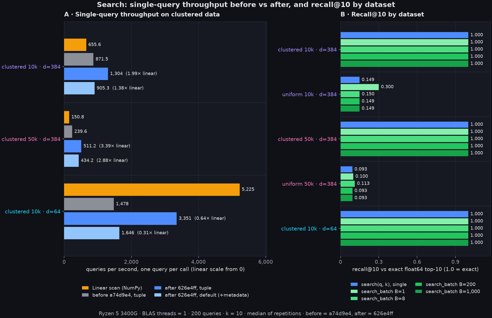
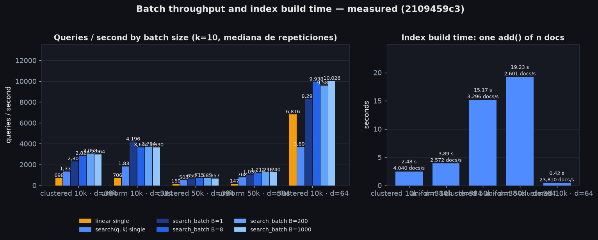
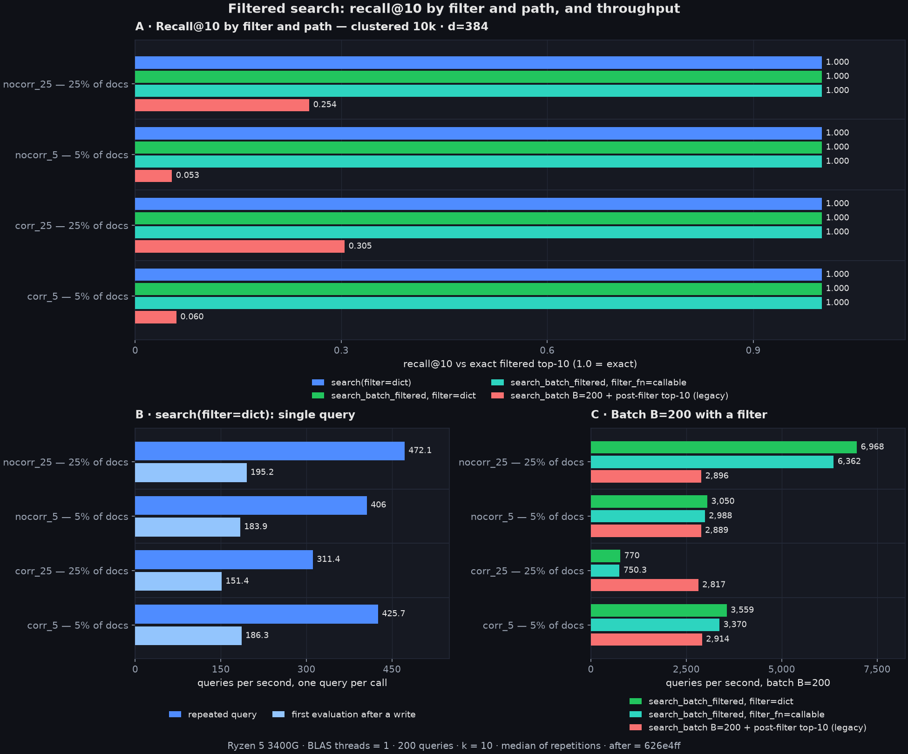
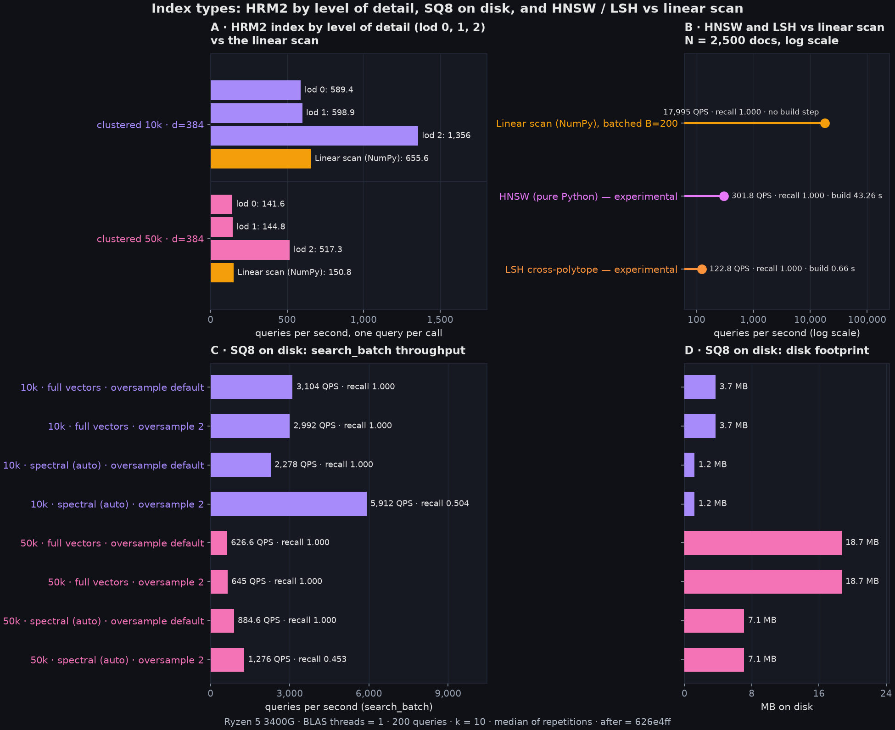
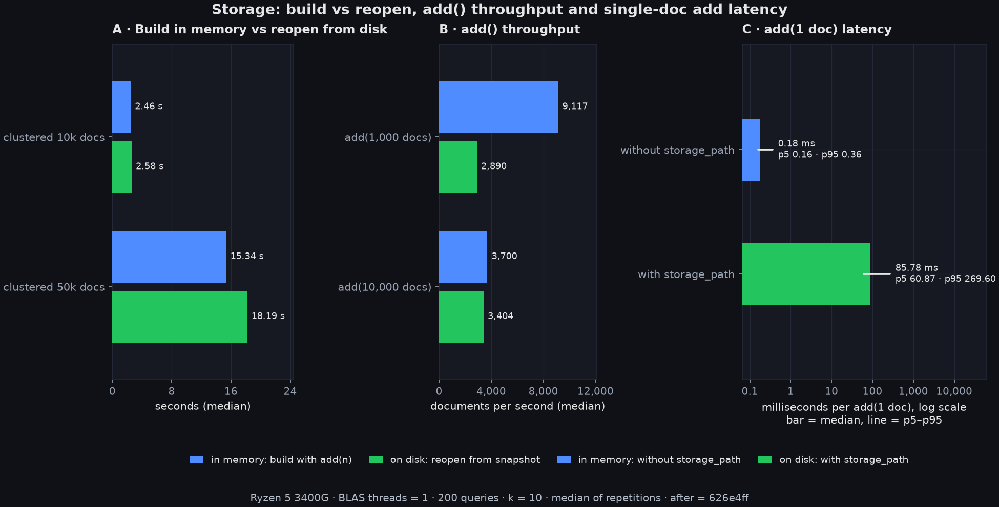

# Benchmarks (measured)

Every number on this page — the tables, the captions and the five figures — is generated from the JSON files in `benchmarks/results/` by `scripts/make_readme_figures.py`; nothing is typed by hand. The same script checks every figure (no overlapping texts, nothing outside the canvas, no value label on top of a bar, byte-identical PNGs on two consecutive runs) and writes `bench-manifest.json` with the SHA-256 of every source file and figure.

```
PYTHONPATH=$PWD/src python scripts/make_readme_figures.py   # figures + manifest + this page
python scripts/make_readme_figures.py --check                 # no hand-typed numbers in the script
```

* **Code measured ("after"):** commit `626e4ff9a` (`meta.commit`; the four after JSON files record 1 distinct commit).
* **Comparison base ("before"):** commit `a74d9e41a`, files under `benchmarks/results/before_a74d9e4/` (search, filtered and index tables; there is no before storage table).
* **Machine:** AMD Ryzen 5 3400G with Radeon Vega Graphics, 8 logical CPUs; Linux-6.18.58.1-microsoft-standard-WSL2-x86_64-with-glibc2.39; Python 3.12.3, NumPy 2.5.5; BLAS threads: OPENBLAS_NUM_THREADS = 1, OMP_NUM_THREADS = 1 (single thread on purpose: with the default BLAS threads the small operations spin-wait on this host).

## Protocol

| Item | Value (from the JSON) |
|---|---|
| Queries | 200 per dataset, drawn with the same generator as the corpus (query seed 7, data seed 42), k = 10 |
| Ground truth | exact float64 brute-force dot product against every row (argpartition + sort); recall@10 = |top-10 ∩ GT| / |GT| |
| Repetitions | warm-up 1; each row repeats between 5 and 200 times until at least 1.0 s of wall time; `qps` = median over repetitions of (queries per repetition ÷ wall time of that repetition); `mediana` / `p5` / `p95` = latency percentiles over all queries of all repetitions |
| Memory | `rss_pico_mb` = peak process RSS sampled from `/proc/self/statm` |
| Filtered table | one corpus (clustered 10k · d=384); reps 5–200 |
| Index-type table | blocks `hrm2_lod,sq8,hnsw_lsh,gate`; HNSW/LSH/gate corpus N = 2,500; gate timeout 90 s |
| Storage table | reopen 3 repetitions, `add()` 2, `add(1 doc)` 100 single adds |

Datasets (`bench_search.json` → `datasets`):

| kind | n | d | n_docs | n_coarse | n_probe | build_s | gt_s | RSS peak during build (MB) |
|---|---|---|---|---|---|---|---|---|
| clustered | 10,000 | 384 | 10,000 | 100 | 5 | 2.568 | 0.105 | 269.3 |
| uniform | 10,000 | 384 | 10,000 | 100 | 5 | 4.019 | 0.086 | 271.6 |
| clustered | 50,000 | 384 | 50,000 | 223 | 5 | 15.982 | 0.692 | 793 |
| uniform | 50,000 | 384 | 50,000 | 223 | 5 | 19.012 | 0.453 | 768.9 |
| clustered | 10,000 | 64 | 10,000 | 100 | 5 | 0.459 | 0.031 | 269.3 |

Corpus generators, as recorded in `protocolo`: clustered = C = round(sqrt(n)) centers ~ N(0, I_d)·2, point = center + N(0, I_d), L2-normalized float32; uniform = N(0, I_d), L2-normalized float32. The verbatim `protocolo` text of each JSON is reproduced in the appendix.

Load average (1/5/15 min) before → after each table:

| Table | Commit | Load before | Load after |
|---|---|---|---|
| `benchmarks/results/bench_search.json` | `626e4ff9a` | `1.16 0.83 0.70 1/539 801519` | `1.10 0.98 0.79 1/542 801829` |
| `benchmarks/results/before_a74d9e4/bench_search.json` | `a74d9e41a` | `0.50 0.95 1.89 1/544 790226` | `1.18 1.08 1.77 2/548 790392` |
| `benchmarks/results/bench_filtered.json` | `626e4ff9a` | `1.10 0.98 0.79 1/542 801839` | `1.19 1.02 0.81 1/539 801904` |
| `benchmarks/results/bench_index_types.json` | `626e4ff9a` | `0.60 0.90 0.86 1/543 802263` | `1.10 1.03 0.93 1/543 802343` |
| `benchmarks/results/bench_storage.json` | `626e4ff9a` | `1.04 1.03 0.86 1/536 801968` | `1.30 1.11 0.91 1/537 801988` |

## Figures

All figures: horizontal bars from zero with the value at the end of the bar (line charts only where a batch-size or a log-scale comparison needs them), English text, comma thousands and dot decimals. Colour key shared by every figure: amber = NumPy linear scan, gray = before commit, blue = single-query path (after), greens = batch paths, violet = 10k · d=384, pink = 50k · d=384, cyan = 10k · d=64.

### Figure 1 — `bench-hero.png`



Left: single-query throughput on clustered data — the NumPy linear scan, `search(q, k)` at the before and after commits (legacy tuple path), and the default call that also returns metadata; the parenthesis is after ÷ linear scan. At d = 384 the tuple path is 1.99×–3.39× the linear scan (default path 1.38×–2.88×). At d = 64 the linear scan is faster than every library path (0.64× tuple, 0.31× default). Right: recall@10 against the exact float64 brute-force top-10 — 1.000 on every clustered row and 0.09–0.30 on uniform data, where the index misses most of the true top-10. What it does not show: peak throughput (next figure), other hardware or BLAS thread counts, or the cause of the recall collapse.

Sources: `benchmarks/results/bench_search.json` (sha256 `de27f5273863a3cd8174fd89db16b55b6f8ca3c730092fe3033715143efa95f9`); `benchmarks/results/before_a74d9e4/bench_search.json` (sha256 `cbf3a4dd1aa7c9f289af70d1ec529608fb16d0538919469e7e5009a3045ca620`).

### Figure 2 — `bench-qps.png`



`search_batch` throughput by batch size B, one line per dataset (violet = 10k · d=384, pink = 50k · d=384, cyan = 10k · d=64; hollow squares = uniform data), against the NumPy linear scan (amber, dashed); log-log axes. Recall@10 is annotated only where it is below 1.0. For B = 200, 1,000 the batched linear scan is faster than `search_batch` in 7 of 10 dataset × batch cells; the library is ahead only on clustered 50k · d=384 at B=1,000, uniform 50k · d=384 at B=1,000, uniform 50k · d=384 at B=200. At B = 1 the library is faster on 5 of 5 datasets. The linear scan was measured at B = 1, 200, 1,000 only; the dashed segment crossing B = 8 is not a measurement. What it does not show: per-query latency (Table 1), multi-threaded BLAS, or the filtered and on-disk paths.

Sources: `benchmarks/results/bench_search.json` (sha256 `de27f5273863a3cd8174fd89db16b55b6f8ca3c730092fe3033715143efa95f9`).

### Figure 3 — `bench-filtered.png`



Filtered search on clustered 10k · d=384: A — recall@10 per filter and path; B — single-query throughput; C — batch throughput. Filters: `nocorr_25` (25.0% of the documents), `nocorr_5` (5.0% of the documents), `corr_25` (25.5% of the documents), `corr_5` (5.2% of the documents). `search(filter=dict)` and both `search_batch_filtered` variants return the exact filtered top-10 (1.000 in every row); the legacy post-filter — fetch an unfiltered top-10 and drop the rows that fail the filter — returns 0.053–0.305. The first evaluation after a public write is 2.1×–2.4× slower than a repeated one (the benchmark forces a cold cache before each cold query — `invalidacion` in the JSON: "escritura publica update(doc0, metadata) antes de cada consulta"). What it does not show: other selectivities, 50k-docs corpora, or the cost of keeping the masks up to date.

Sources: `benchmarks/results/bench_filtered.json` (sha256 `84ec1c676bf7b67d9fb9a299b6ff6a1bab2cb579d7e7c5299c44b7b11f0bc788`).

### Figure 4 — `bench-index.png`



A — single-query QPS of the HRM2 index by level of detail (lod 0, 1, 2) against the linear scan measured in the same session (`bench_search.json`); B — on a 2,500-doc corpus, pure-Python HNSW and cross-polytope LSH against the batched linear scan recorded in the same table (log scale); C and D — SQ8 on disk: `search_batch` throughput and disk footprint per mode (`full vectors`, `spectral (auto)`) and oversampling, recall at the end of each bar in C. HRM2 is faster than the linear scan only at lod = 2 (clustered 10k · d=384: lod 0 = 0.90×, lod 1 = 0.91×, lod 2 = 2.07×; clustered 50k · d=384: lod 0 = 0.94×, lod 1 = 0.96×, lod 2 = 3.43×). SQ8 recall is below 1.0 in 2 of 8 rows (10k · spectral (auto) · oversample 2: 0.504, 50k · spectral (auto) · oversample 2: 0.453). HNSW (301.8 QPS, build 43.3 s) and LSH (122.8 QPS) are far below the linear reference (17,995 QPS). What it does not show: tuned or native HNSW/LSH, SQ8 above 50k docs, or a like-for-like HNSW/LSH comparison — the reference row is a batched scan and both index types answer one query per call.

Sources: `benchmarks/results/bench_index_types.json` (sha256 `d3fd93cc526ac772e413ab6662d57f4365725d21cc93ca3016be7f14182faa2c`); `benchmarks/results/bench_search.json` (sha256 `de27f5273863a3cd8174fd89db16b55b6f8ca3c730092fe3033715143efa95f9`).

### Figure 5 — `bench-storage.png`



A — building the index in memory (`add(n)`) versus reopening it from a snapshot (`save(path)` + `SimpleVectorDB(storage_path=path)`); B — `add()` throughput with and without `storage_path`; C — latency of `add(1 doc)` with and without `storage_path` (bar = median, line = p5–p95; log scale, because the two medians are 0.18 ms and 86 ms apart). Reopening costs 1.05× the in-memory build at 10k docs, 1.19× the in-memory build at 50k docs. A single-doc add takes a median of 0.18 ms without `storage_path` and 85.78 ms with it (p95 269.60 ms). Repetitions per row in this table are few (build: 1; reopen: 3; `add()`: 2; `add(1 doc)`: 100): read these as order-of-magnitude figures, not as precise medians. What it does not show: a before/after comparison (there is no before storage table), concurrent writers, or other storage backends.

Sources: `benchmarks/results/bench_storage.json` (sha256 `fcc659d4134ef4959fa8eb7e8bcf5d6e63f8073ecce033fcf812e51b627d8380`).

## Tables

Column names are the JSON keys and values are printed exactly as stored (no rounding). `n/a` = null in the JSON; a row recorded as `n/d` (not measured) keeps its `estado` / `motivo` columns.

### Table 1 — `benchmarks/results/bench_search.json` (bench_search.json — after; commit `626e4ff9a`, sha256 `de27f5273863a3cd8174fd89db16b55b6f8ca3c730092fe3033715143efa95f9`)

| dataset.kind | dataset.n | dataset.d | parametro | camino | B | n_repeticiones | mediana | p5 | p95 | qps | recall@10 | rss_pico_mb | build_s |
| --- | --- | --- | --- | --- | --- | --- | --- | --- | --- | --- | --- | --- | --- |
| clustered | 10,000 | 384 | linear_single (X @ q + top-10) | baseline | n/a | 5 | 1.4866 | 1.4175 | 1.7549 | 655.6 | 1 | 176.7 | n/a |
| clustered | 10,000 | 384 | linear_batched B=200 (Q @ X.T) | baseline | n/a | 24 | 0.2152 | 0.2105 | 0.2229 | 4,647.8 | 1 | 192.1 | n/a |
| clustered | 10,000 | 384 | linear_batched B=1000 (200 queries x5) | baseline | n/a | 5 | 0.2237 | 0.2213 | 0.2314 | 4,469.8 | 1 | 343.2 | n/a |
| clustered | 10,000 | 384 | search(q,k) legacy (tupla) | m2m | n/a | 7 | 0.7141 | 0.6234 | 1.0908 | 1,304.3 | 1 | 269.3 | 2.568 |
| clustered | 10,000 | 384 | search(q,k) include_metadata=True | m2m | n/a | 5 | 1.0615 | 0.9039 | 1.5402 | 905.3 | 1 | 269.3 | 2.568 |
| clustered | 10,000 | 384 | search_batch B=1 | m2m | 1 | 200 | 0.4567 | 0.3963 | 0.7351 | 2,189.8 | 1 | 269.3 | 2.568 |
| clustered | 10,000 | 384 | search_batch B=8 | m2m | 8 | 200 | 0.3846 | 0.3181 | 0.5822 | 2,600.2 | 1 | 269.3 | 2.568 |
| clustered | 10,000 | 384 | search_batch B=200 | m2m | 200 | 10 | 0.5646 | 0.3675 | 0.6314 | 1,771.1 | 1 | 269.3 | 2.568 |
| clustered | 10,000 | 384 | search_batch B=1000 (200 queries x5) | m2m | 1,000 | 5 | 0.4018 | 0.3884 | 0.4319 | 2,488.6 | 1 | 415.8 | 2.568 |
| uniform | 10,000 | 384 | linear_single (X @ q + top-10) | baseline | n/a | 5 | 1.4909 | 1.4184 | 1.7967 | 659.3 | 1 | 253 | n/a |
| uniform | 10,000 | 384 | linear_batched B=200 (Q @ X.T) | baseline | n/a | 22 | 0.2223 | 0.2123 | 0.2714 | 4,497.5 | 1 | 253 | n/a |
| uniform | 10,000 | 384 | linear_batched B=1000 (200 queries x5) | baseline | n/a | 5 | 0.2256 | 0.2215 | 0.2648 | 4,432.9 | 1 | 367.4 | n/a |
| uniform | 10,000 | 384 | search(q,k) legacy (tupla) | m2m | n/a | 9 | 0.5245 | 0.4399 | 0.873 | 1,745.1 | 0.149 | 271.6 | 4.019 |
| uniform | 10,000 | 384 | search(q,k) include_metadata=True | m2m | n/a | 6 | 0.8413 | 0.7137 | 1.3201 | 1,099.9 | 0.149 | 271.6 | 4.019 |
| uniform | 10,000 | 384 | search_batch B=1 | m2m | 1 | 200 | 0.2625 | 0.2236 | 0.5655 | 3,809.3 | 0.3 | 271.6 | 4.019 |
| uniform | 10,000 | 384 | search_batch B=8 | m2m | 8 | 200 | 0.293 | 0.2564 | 0.3653 | 3,412.5 | 0.15 | 271.6 | 4.019 |
| uniform | 10,000 | 384 | search_batch B=200 | m2m | 200 | 18 | 0.2814 | 0.2726 | 0.2915 | 3,554 | 0.149 | 271.6 | 4.019 |
| uniform | 10,000 | 384 | search_batch B=1000 (200 queries x5) | m2m | 1,000 | 5 | 0.2954 | 0.2914 | 0.2998 | 3,385.3 | 0.149 | 418.1 | 4.019 |
| clustered | 50,000 | 384 | linear_single (X @ q + top-10) | baseline | n/a | 5 | 6.5589 | 6.2961 | 9.1161 | 150.8 | 1 | 333.3 | n/a |
| clustered | 50,000 | 384 | linear_batched B=200 (Q @ X.T) | baseline | n/a | 5 | 1.1607 | 1.1225 | 1.1696 | 861.6 | 1 | 446.3 | n/a |
| clustered | 50,000 | 384 | linear_batched B=1000 (200 queries x5) | baseline | n/a | 5 | 1.7995 | 1.7253 | 2.1743 | 555.7 | 1 | 1,094 | n/a |
| clustered | 50,000 | 384 | search(q,k) legacy (tupla) | m2m | n/a | 5 | 2.0079 | 1.6952 | 2.9717 | 511.2 | 1 | 550.3 | 15.982 |
| clustered | 50,000 | 384 | search(q,k) include_metadata=True | m2m | n/a | 5 | 2.2577 | 1.9699 | 2.7963 | 434.2 | 1 | 550.3 | 15.982 |
| clustered | 50,000 | 384 | search_batch B=1 | m2m | 1 | 200 | 1.5575 | 1.4241 | 1.8097 | 642 | 1 | 550.3 | 15.982 |
| clustered | 50,000 | 384 | search_batch B=8 | m2m | 8 | 90 | 1.3974 | 1.3334 | 1.4863 | 715.6 | 1 | 552.6 | 15.982 |
| clustered | 50,000 | 384 | search_batch B=200 | m2m | 200 | 5 | 1.4478 | 1.4405 | 1.4867 | 690.7 | 1 | 618 | 15.982 |
| clustered | 50,000 | 384 | search_batch B=1000 (200 queries x5) | m2m | 1,000 | 5 | 1.6546 | 1.6342 | 1.6576 | 604.4 | 1 | 879.3 | 15.982 |
| uniform | 50,000 | 384 | linear_single (X @ q + top-10) | baseline | n/a | 5 | 6.5424 | 6.2458 | 8.2409 | 148.3 | 1 | 310.2 | n/a |
| uniform | 50,000 | 384 | linear_batched B=200 (Q @ X.T) | baseline | n/a | 5 | 1.1854 | 1.1418 | 1.2456 | 843.6 | 1 | 462.6 | n/a |
| uniform | 50,000 | 384 | linear_batched B=1000 (200 queries x5) | baseline | n/a | 5 | 1.6391 | 1.6139 | 1.9196 | 610.1 | 1 | 1,072.9 | n/a |
| uniform | 50,000 | 384 | search(q,k) legacy (tupla) | m2m | n/a | 5 | 1.2304 | 1.0506 | 1.583 | 787.5 | 0.093 | 546.4 | 19.012 |
| uniform | 50,000 | 384 | search(q,k) include_metadata=True | m2m | n/a | 5 | 1.5828 | 1.354 | 2.1582 | 612.1 | 0.093 | 546.4 | 19.012 |
| uniform | 50,000 | 384 | search_batch B=1 | m2m | 1 | 200 | 0.9741 | 0.8861 | 1.2631 | 1,026.6 | 0.1 | 546.4 | 19.012 |
| uniform | 50,000 | 384 | search_batch B=8 | m2m | 8 | 152 | 0.8027 | 0.7603 | 0.9532 | 1,245.8 | 0.1125 | 549 | 19.012 |
| uniform | 50,000 | 384 | search_batch B=200 | m2m | 200 | 6 | 0.905 | 0.8038 | 1.1159 | 1,111.7 | 0.093 | 614.4 | 19.012 |
| uniform | 50,000 | 384 | search_batch B=1000 (200 queries x5) | m2m | 1,000 | 5 | 0.9595 | 0.8962 | 0.9791 | 1,042.2 | 0.093 | 875.7 | 19.012 |
| clustered | 10,000 | 64 | linear_single (X @ q + top-10) | baseline | n/a | 27 | 0.16 | 0.1272 | 0.3728 | 5,224.6 | 1 | 269.5 | n/a |
| clustered | 10,000 | 64 | linear_batched B=200 (Q @ X.T) | baseline | n/a | 57 | 0.0837 | 0.0818 | 0.1083 | 11,953.1 | 1 | 269.5 | n/a |
| clustered | 10,000 | 64 | linear_batched B=1000 (200 queries x5) | baseline | n/a | 9 | 0.1116 | 0.1016 | 0.1368 | 8,960.4 | 1 | 420.1 | n/a |
| clustered | 10,000 | 64 | search(q,k) legacy (tupla) | m2m | n/a | 16 | 0.2632 | 0.2225 | 0.6332 | 3,350.9 | 1 | 269.3 | 0.459 |
| clustered | 10,000 | 64 | search(q,k) include_metadata=True | m2m | n/a | 8 | 0.5244 | 0.4545 | 1.2166 | 1,645.5 | 1 | 269.3 | 0.459 |
| clustered | 10,000 | 64 | search_batch B=1 | m2m | 1 | 200 | 0.1077 | 0.1053 | 0.273 | 9,285.9 | 1 | 269.3 | 0.459 |
| clustered | 10,000 | 64 | search_batch B=8 | m2m | 8 | 200 | 0.1055 | 0.0843 | 0.1746 | 9,479 | 1 | 269.3 | 0.459 |
| clustered | 10,000 | 64 | search_batch B=200 | m2m | 200 | 49 | 0.1009 | 0.0912 | 0.1128 | 9,907.5 | 1 | 269.3 | 0.459 |
| clustered | 10,000 | 64 | search_batch B=1000 (200 queries x5) | m2m | 1,000 | 9 | 0.1133 | 0.1012 | 0.1407 | 8,824.9 | 1 | 269.3 | 0.459 |

### Table 2 — `benchmarks/results/before_a74d9e4/bench_search.json` (before_a74d9e4/bench_search.json — before, used by Figure 1; commit `a74d9e41a`, sha256 `cbf3a4dd1aa7c9f289af70d1ec529608fb16d0538919469e7e5009a3045ca620`)

| dataset.kind | dataset.n | dataset.d | parametro | camino | B | n_repeticiones | mediana | p5 | p95 | qps | recall@10 | rss_pico_mb | build_s |
| --- | --- | --- | --- | --- | --- | --- | --- | --- | --- | --- | --- | --- | --- |
| clustered | 10,000 | 384 | linear_single (X @ q + top-10) | baseline | n/a | 5 | 1.4779 | 1.3908 | 1.8046 | 656.8 | 1 | 176.7 | n/a |
| clustered | 10,000 | 384 | linear_batched B=200 (Q @ X.T) | baseline | n/a | 24 | 0.2152 | 0.2083 | 0.2224 | 4,647.3 | 1 | 192.1 | n/a |
| clustered | 10,000 | 384 | linear_batched B=1000 (200 queries x5) | baseline | n/a | 5 | 0.2195 | 0.216 | 0.2234 | 4,555.8 | 1 | 344.9 | n/a |
| clustered | 10,000 | 384 | search(q,k) legacy (tupla) | m2m | n/a | 5 | 1.0972 | 0.9867 | 1.4658 | 871.5 | 1 | 254.4 | 2.451 |
| clustered | 10,000 | 384 | search(q,k) include_metadata=True | m2m | n/a | 5 | 1.1882 | 1.0469 | 1.611 | 814.8 | 1 | 254.4 | 2.451 |
| clustered | 10,000 | 384 | search_batch B=1 | m2m | 1 | 200 | 1.2393 | 1.0726 | 1.7596 | 806.9 | 1 | 254.4 | 2.451 |
| clustered | 10,000 | 384 | search_batch B=8 | m2m | 8 | 200 | 0.3618 | 0.3393 | 0.4171 | 2,764.2 | 1 | 254.4 | 2.451 |
| clustered | 10,000 | 384 | search_batch B=200 | m2m | 200 | 18 | 0.2882 | 0.2783 | 0.3088 | 3,470.4 | 1 | 258.6 | 2.451 |
| clustered | 10,000 | 384 | search_batch B=1000 (200 queries x5) | m2m | 1,000 | 5 | 0.2871 | 0.2806 | 0.2887 | 3,483 | 1 | 515.8 | 2.451 |
| uniform | 10,000 | 384 | linear_single (X @ q + top-10) | baseline | n/a | 5 | 1.3992 | 1.3111 | 1.8235 | 710.5 | 1 | 243.7 | n/a |
| uniform | 10,000 | 384 | linear_batched B=200 (Q @ X.T) | baseline | n/a | 21 | 0.2294 | 0.2143 | 0.325 | 4,359.9 | 1 | 243.7 | n/a |
| uniform | 10,000 | 384 | linear_batched B=1000 (200 queries x5) | baseline | n/a | 5 | 0.2198 | 0.2097 | 0.237 | 4,549.9 | 1 | 356.3 | n/a |
| uniform | 10,000 | 384 | search(q,k) legacy (tupla) | m2m | n/a | 5 | 0.9762 | 0.8655 | 1.4032 | 961.2 | 0.149 | 260.7 | 3.919 |
| uniform | 10,000 | 384 | search(q,k) include_metadata=True | m2m | n/a | 5 | 1.0574 | 0.9219 | 1.508 | 884.7 | 0.149 | 260.8 | 3.919 |
| uniform | 10,000 | 384 | search_batch B=1 | m2m | 1 | 200 | 1.1245 | 0.9828 | 1.6057 | 889.3 | 0.3 | 260.8 | 3.919 |
| uniform | 10,000 | 384 | search_batch B=8 | m2m | 8 | 200 | 0.5424 | 0.5241 | 0.643 | 1,843.8 | 0.425 | 260.8 | 3.919 |
| uniform | 10,000 | 384 | search_batch B=200 | m2m | 200 | 17 | 0.3022 | 0.2922 | 0.328 | 3,309.2 | 1 | 261.1 | 3.919 |
| uniform | 10,000 | 384 | search_batch B=1000 (200 queries x5) | m2m | 1,000 | 5 | 0.3008 | 0.2945 | 0.3045 | 3,324.8 | 1 | 522.1 | 3.919 |
| clustered | 50,000 | 384 | linear_single (X @ q + top-10) | baseline | n/a | 5 | 6.4512 | 6.2628 | 8.1792 | 150.2 | 1 | 322.9 | n/a |
| clustered | 50,000 | 384 | linear_batched B=200 (Q @ X.T) | baseline | n/a | 5 | 1.1399 | 1.0974 | 1.1623 | 877.3 | 1 | 436.1 | n/a |
| clustered | 50,000 | 384 | linear_batched B=1000 (200 queries x5) | baseline | n/a | 5 | 1.0913 | 1.0755 | 1.4205 | 916.3 | 1 | 1,085.9 | n/a |
| clustered | 50,000 | 384 | search(q,k) legacy (tupla) | m2m | n/a | 5 | 4.1221 | 3.8275 | 5.0906 | 239.6 | 1 | 478.2 | 15.568 |
| clustered | 50,000 | 384 | search(q,k) include_metadata=True | m2m | n/a | 5 | 4.276 | 3.9106 | 5.2125 | 231.6 | 1 | 478.3 | 15.568 |
| clustered | 50,000 | 384 | search_batch B=1 | m2m | 1 | 200 | 4.2858 | 4.0005 | 5.1604 | 233.3 | 1 | 478.3 | 15.568 |
| clustered | 50,000 | 384 | search_batch B=8 | m2m | 8 | 113 | 1.0822 | 1.0635 | 1.2498 | 924 | 1 | 480.2 | 15.568 |
| clustered | 50,000 | 384 | search_batch B=200 | m2m | 200 | 6 | 1.0003 | 0.9865 | 1.0129 | 999.7 | 1 | 652.2 | 15.568 |
| clustered | 50,000 | 384 | search_batch B=1000 (200 queries x5) | m2m | 1,000 | 5 | 1.024 | 0.9939 | 1.1201 | 976.5 | 1 | 1,156.1 | 15.568 |
| uniform | 50,000 | 384 | linear_single (X @ q + top-10) | baseline | n/a | 5 | 6.5023 | 6.2387 | 8.6345 | 149 | 1 | 315.9 | n/a |
| uniform | 50,000 | 384 | linear_batched B=200 (Q @ X.T) | baseline | n/a | 5 | 1.1176 | 1.0952 | 1.3479 | 894.8 | 1 | 430.3 | n/a |
| uniform | 50,000 | 384 | linear_batched B=1000 (200 queries x5) | baseline | n/a | 5 | 1.3252 | 1.087 | 1.3578 | 754.6 | 1 | 1,078.3 | n/a |
| uniform | 50,000 | 384 | search(q,k) legacy (tupla) | m2m | n/a | 5 | 3.4888 | 3.2479 | 4.3063 | 283.4 | 0.093 | 470.9 | 19.996 |
| uniform | 50,000 | 384 | search(q,k) include_metadata=True | m2m | n/a | 5 | 3.5701 | 3.3084 | 4.3245 | 277.9 | 0.093 | 471 | 19.996 |
| uniform | 50,000 | 384 | search_batch B=1 | m2m | 1 | 200 | 4.0907 | 3.8342 | 4.7141 | 244.5 | 0.1 | 471 | 19.996 |
| uniform | 50,000 | 384 | search_batch B=8 | m2m | 8 | 93 | 1.3416 | 1.306 | 1.4376 | 745.4 | 0.225 | 483.2 | 19.996 |
| uniform | 50,000 | 384 | search_batch B=200 | m2m | 200 | 5 | 1.5117 | 1.4955 | 1.5939 | 661.5 | 0.999 | 662.2 | 19.996 |
| uniform | 50,000 | 384 | search_batch B=1000 (200 queries x5) | m2m | 1,000 | 5 | 2.1453 | 2.0793 | 2.1642 | 466.1 | 0.999 | 1,380.1 | 19.996 |
| clustered | 10,000 | 64 | linear_single (X @ q + top-10) | baseline | n/a | 33 | 0.1247 | 0.1096 | 0.2778 | 6,853.8 | 1 | 258.6 | n/a |
| clustered | 10,000 | 64 | linear_batched B=200 (Q @ X.T) | baseline | n/a | 57 | 0.0872 | 0.0812 | 0.1048 | 11,463.6 | 1 | 258.6 | n/a |
| clustered | 10,000 | 64 | linear_batched B=1000 (200 queries x5) | baseline | n/a | 10 | 0.0978 | 0.0908 | 0.1325 | 10,255.7 | 1 | 372.5 | n/a |
| clustered | 10,000 | 64 | search(q,k) legacy (tupla) | m2m | n/a | 8 | 0.6178 | 0.5383 | 1.0691 | 1,477.5 | 1 | 258.6 | 0.468 |
| clustered | 10,000 | 64 | search(q,k) include_metadata=True | m2m | n/a | 7 | 0.6941 | 0.591 | 1.1856 | 1,332.3 | 1 | 258.6 | 0.468 |
| clustered | 10,000 | 64 | search_batch B=1 | m2m | 1 | 200 | 0.6843 | 0.6212 | 1.2357 | 1,461.4 | 1 | 258.6 | 0.468 |
| clustered | 10,000 | 64 | search_batch B=8 | m2m | 8 | 200 | 0.194 | 0.1755 | 0.2494 | 5,153.3 | 1 | 258.6 | 0.468 |
| clustered | 10,000 | 64 | search_batch B=200 | m2m | 200 | 42 | 0.1185 | 0.1171 | 0.1338 | 8,437.5 | 1 | 258.6 | 0.468 |
| clustered | 10,000 | 64 | search_batch B=1000 (200 queries x5) | m2m | 1,000 | 8 | 0.1308 | 0.1284 | 0.1433 | 7,644.1 | 1 | 373.1 | 0.468 |

### Table 3 — `benchmarks/results/bench_filtered.json` (bench_filtered.json; commit `626e4ff9a`, sha256 `84ec1c676bf7b67d9fb9a299b6ff6a1bab2cb579d7e7c5299c44b7b11f0bc788`)

| dataset.kind | dataset.n | dataset.d | parametro | camino | B | n_repeticiones | mediana | p5 | p95 | qps | recall@10 | rss_pico_mb | build_s | filtro_nombre | filtro | selectividad | descripcion | qps_definicion | invalidacion_verificada | invalidacion |
| --- | --- | --- | --- | --- | --- | --- | --- | --- | --- | --- | --- | --- | --- | --- | --- | --- | --- | --- | --- | --- |
| clustered | 10,000 | 384 | search(filter=dict) repetida [nocorr_25] | single_filtro | n/a | 5 | 2.0241 | 1.872 | 2.5988 | 472.1 | 1 | 228 | 2.574 | nocorr_25 | {"bucket":0} | 0.25 | no correlacionado: i % 4 == 0 | n/a | n/a | n/a |
| clustered | 10,000 | 384 | search(filter=dict) 1ra evaluacion [nocorr_25] | single_filtro_frio | n/a | 20 | 5.1237 | 4.8427 | 6.1838 | 195.2 | 1 | 228.1 | 2.574 | nocorr_25 | {"bucket":0} | 0.25 | no correlacionado: i % 4 == 0 | 1 / latencia mediana de evaluaciones frías individuales | true | escritura publica update(doc0, metadata) antes de cada consulta |
| clustered | 10,000 | 384 | search_batch_filtered B=200 filter=dict [nocorr_25] | batch_filtro_dict | 200 | 35 | 0.1435 | 0.1389 | 0.1535 | 6,968.3 | 1 | 257.2 | 2.574 | nocorr_25 | {"bucket":0} | 0.25 | no correlacionado: i % 4 == 0 | n/a | n/a | n/a |
| clustered | 10,000 | 384 | search_batch_filtered B=200 filter_fn=callable [nocorr_25] | batch_filtro_fn | 200 | 32 | 0.1572 | 0.1526 | 0.1731 | 6,362.2 | 1 | 257.2 | 2.574 | nocorr_25 | {"bucket":0} | 0.25 | no correlacionado: i % 4 == 0 | n/a | n/a | n/a |
| clustered | 10,000 | 384 | search_batch B=200 + post-filtro top-10 [nocorr_25] | batch_postfiltro | 200 | 15 | 0.3454 | 0.3375 | 0.3602 | 2,895.6 | 0.2535 | 257.2 | 2.574 | nocorr_25 | {"bucket":0} | 0.25 | no correlacionado: i % 4 == 0 | n/a | n/a | n/a |
| clustered | 10,000 | 384 | search(filter=dict) repetida [nocorr_5] | single_filtro | n/a | 5 | 2.3543 | 2.1845 | 2.9726 | 406 | 1 | 228.1 | 2.574 | nocorr_5 | {"bucket20":0} | 0.05 | no correlacionado: i % 20 == 0 | n/a | n/a | n/a |
| clustered | 10,000 | 384 | search(filter=dict) 1ra evaluacion [nocorr_5] | single_filtro_frio | n/a | 20 | 5.4374 | 5.0658 | 5.8527 | 183.9 | 1 | 228.1 | 2.574 | nocorr_5 | {"bucket20":0} | 0.05 | no correlacionado: i % 20 == 0 | 1 / latencia mediana de evaluaciones frías individuales | true | escritura publica update(doc0, metadata) antes de cada consulta |
| clustered | 10,000 | 384 | search_batch_filtered B=200 filter=dict [nocorr_5] | batch_filtro_dict | 200 | 16 | 0.3278 | 0.3135 | 0.3453 | 3,050.4 | 1 | 257.3 | 2.574 | nocorr_5 | {"bucket20":0} | 0.05 | no correlacionado: i % 20 == 0 | n/a | n/a | n/a |
| clustered | 10,000 | 384 | search_batch_filtered B=200 filter_fn=callable [nocorr_5] | batch_filtro_fn | 200 | 15 | 0.3346 | 0.3241 | 0.3553 | 2,988.4 | 1 | 257.3 | 2.574 | nocorr_5 | {"bucket20":0} | 0.05 | no correlacionado: i % 20 == 0 | n/a | n/a | n/a |
| clustered | 10,000 | 384 | search_batch B=200 + post-filtro top-10 [nocorr_5] | batch_postfiltro | 200 | 15 | 0.3462 | 0.3389 | 0.3693 | 2,888.7 | 0.0535 | 257.3 | 2.574 | nocorr_5 | {"bucket20":0} | 0.05 | no correlacionado: i % 20 == 0 | n/a | n/a | n/a |
| clustered | 10,000 | 384 | search(filter=dict) repetida [corr_25] | single_filtro | n/a | 5 | 3.4822 | 1.9283 | 4.3399 | 311.4 | 1 | 228.1 | 2.574 | corr_25 | {"cl25":1} | 0.2548 | correlacionado: 1/4 de los clusters verdaderos | n/a | n/a | n/a |
| clustered | 10,000 | 384 | search(filter=dict) 1ra evaluacion [corr_25] | single_filtro_frio | n/a | 20 | 6.6043 | 4.9961 | 7.2315 | 151.4 | 1 | 228.1 | 2.574 | corr_25 | {"cl25":1} | 0.2548 | correlacionado: 1/4 de los clusters verdaderos | 1 / latencia mediana de evaluaciones frías individuales | true | escritura publica update(doc0, metadata) antes de cada consulta |
| clustered | 10,000 | 384 | search_batch_filtered B=200 filter=dict [corr_25] | batch_filtro_dict | 200 | 5 | 1.2987 | 1.2946 | 1.3483 | 770 | 1 | 257.3 | 2.574 | corr_25 | {"cl25":1} | 0.2548 | correlacionado: 1/4 de los clusters verdaderos | n/a | n/a | n/a |
| clustered | 10,000 | 384 | search_batch_filtered B=200 filter_fn=callable [corr_25] | batch_filtro_fn | 200 | 5 | 1.3328 | 1.3167 | 1.3394 | 750.3 | 1 | 257.3 | 2.574 | corr_25 | {"cl25":1} | 0.2548 | correlacionado: 1/4 de los clusters verdaderos | n/a | n/a | n/a |
| clustered | 10,000 | 384 | search_batch B=200 + post-filtro top-10 [corr_25] | batch_postfiltro | 200 | 15 | 0.355 | 0.3465 | 0.3715 | 2,817.2 | 0.305 | 257.3 | 2.574 | corr_25 | {"cl25":1} | 0.2548 | correlacionado: 1/4 de los clusters verdaderos | n/a | n/a | n/a |
| clustered | 10,000 | 384 | search(filter=dict) repetida [corr_5] | single_filtro | n/a | 5 | 2.276 | 2.1219 | 2.8689 | 425.7 | 1 | 228.1 | 2.574 | corr_5 | {"cl5":1} | 0.0521 | correlacionado: 1/20 de los clusters verdaderos | n/a | n/a | n/a |
| clustered | 10,000 | 384 | search(filter=dict) 1ra evaluacion [corr_5] | single_filtro_frio | n/a | 20 | 5.3684 | 5.0771 | 6.8667 | 186.3 | 1 | 228.2 | 2.574 | corr_5 | {"cl5":1} | 0.0521 | correlacionado: 1/20 de los clusters verdaderos | 1 / latencia mediana de evaluaciones frías individuales | true | escritura publica update(doc0, metadata) antes de cada consulta |
| clustered | 10,000 | 384 | search_batch_filtered B=200 filter=dict [corr_5] | batch_filtro_dict | 200 | 18 | 0.281 | 0.2678 | 0.2963 | 3,559 | 1 | 257.3 | 2.574 | corr_5 | {"cl5":1} | 0.0521 | correlacionado: 1/20 de los clusters verdaderos | n/a | n/a | n/a |
| clustered | 10,000 | 384 | search_batch_filtered B=200 filter_fn=callable [corr_5] | batch_filtro_fn | 200 | 17 | 0.2968 | 0.283 | 0.3085 | 3,369.5 | 1 | 257.3 | 2.574 | corr_5 | {"cl5":1} | 0.0521 | correlacionado: 1/20 de los clusters verdaderos | n/a | n/a | n/a |
| clustered | 10,000 | 384 | search_batch B=200 + post-filtro top-10 [corr_5] | batch_postfiltro | 200 | 15 | 0.3431 | 0.336 | 0.3575 | 2,914.5 | 0.06 | 257.3 | 2.574 | corr_5 | {"cl5":1} | 0.0521 | correlacionado: 1/20 de los clusters verdaderos | n/a | n/a | n/a |

### Table 4 — `benchmarks/results/bench_index_types.json` (bench_index_types.json; commit `626e4ff9a`, sha256 `d3fd93cc526ac772e413ab6662d57f4365725d21cc93ca3016be7f14182faa2c`)

| dataset.kind | dataset.n | dataset.d | parametro | camino | n_repeticiones | mediana | p5 | p95 | qps | recall@10 | rss_pico_mb | build_s | lod | modo | spectral_r | ram_arrays_mb | disco_mb | load_s | n_items | qps_definicion | veredicto | timeout_s | carga_cpu_sistema_pct |
| --- | --- | --- | --- | --- | --- | --- | --- | --- | --- | --- | --- | --- | --- | --- | --- | --- | --- | --- | --- | --- | --- | --- | --- |
| clustered | 10,000 | 384 | hrm2 retrieve(q, k=10, lod=0) | hrm2_lod | 5 | 1.651 | 1.5626 | 1.9582 | 589.4 | 1 | 268.6 | 2.479 | 0 | n/a | n/a | n/a | n/a | n/a | n/a | n/a | n/a | n/a | n/a |
| clustered | 10,000 | 384 | hrm2 retrieve(q, k=10, lod=1) | hrm2_lod | 5 | 1.6074 | 1.5169 | 1.9645 | 598.9 | 1 | 268.6 | 2.479 | 1 | n/a | n/a | n/a | n/a | n/a | n/a | n/a | n/a | n/a | n/a |
| clustered | 10,000 | 384 | hrm2 retrieve(q, k=10, lod=2) | hrm2_lod | 7 | 0.6827 | 0.5984 | 1.0238 | 1,356 | 1 | 268.6 | 2.479 | 2 | n/a | n/a | n/a | n/a | n/a | n/a | n/a | n/a | n/a | n/a |
| clustered | 50,000 | 384 | hrm2 retrieve(q, k=10, lod=0) | hrm2_lod | 5 | 6.8029 | 6.5429 | 8.3639 | 141.6 | 1 | 577.1 | 15.521 | 0 | n/a | n/a | n/a | n/a | n/a | n/a | n/a | n/a | n/a | n/a |
| clustered | 50,000 | 384 | hrm2 retrieve(q, k=10, lod=1) | hrm2_lod | 5 | 6.7373 | 6.5407 | 8.0906 | 144.8 | 1 | 577.1 | 15.521 | 1 | n/a | n/a | n/a | n/a | n/a | n/a | n/a | n/a | n/a | n/a |
| clustered | 50,000 | 384 | hrm2 retrieve(q, k=10, lod=2) | hrm2_lod | 5 | 1.8952 | 1.6893 | 2.3053 | 517.3 | 1 | 577.1 | 15.521 | 2 | n/a | n/a | n/a | n/a | n/a | n/a | n/a | n/a | n/a | n/a |
| clustered | 10,000 | 384 | sq8_disk modo=completo search_batch(k=10, oversample=default) | sq8 | 16 | 0.3222 | 0.3132 | 0.3429 | 3,103.5 | 1 | 280.8 | 0.037 | n/a | completo | n/a | 3.7 | 3.7 | 0.002 | 10,000 | n/a | n/a | n/a | n/a |
| clustered | 10,000 | 384 | sq8_disk modo=completo search_batch(k=10, oversample=2) | sq8 | 15 | 0.3342 | 0.3121 | 0.3651 | 2,991.8 | 1 | 280.8 | 0.035 | n/a | completo | n/a | 3.7 | 3.7 | 0.002 | 10,000 | n/a | n/a | n/a | n/a |
| clustered | 10,000 | 384 | sq8_disk modo=espectral_auto search_batch(k=10, oversample=default) | sq8 | 11 | 0.439 | 0.4201 | 0.5776 | 2,278 | 1 | 282.3 | 0.144 | n/a | espectral_auto | auto | 1 | 1.2 | 0.001 | 10,000 | n/a | n/a | n/a | n/a |
| clustered | 10,000 | 384 | sq8_disk modo=espectral_auto search_batch(k=10, oversample=2) | sq8 | 30 | 0.1691 | 0.1648 | 0.1829 | 5,912.1 | 0.5045 | 282.3 | 0.12 | n/a | espectral_auto | auto | 1 | 1.2 | 0.001 | 10,000 | n/a | n/a | n/a | n/a |
| clustered | 50,000 | 384 | sq8_disk modo=completo search_batch(k=10, oversample=default) | sq8 | 5 | 1.5959 | 1.5611 | 1.748 | 626.6 | 1 | 556.4 | 0.232 | n/a | completo | n/a | 18.7 | 18.7 | 0.005 | 50,000 | n/a | n/a | n/a | n/a |
| clustered | 50,000 | 384 | sq8_disk modo=completo search_batch(k=10, oversample=2) | sq8 | 5 | 1.5504 | 1.524 | 1.6227 | 645 | 1 | 558.4 | 0.221 | n/a | completo | n/a | 18.7 | 18.7 | 0.004 | 50,000 | n/a | n/a | n/a | n/a |
| clustered | 50,000 | 384 | sq8_disk modo=espectral_auto search_batch(k=10, oversample=default) | sq8 | 5 | 1.1304 | 1.12 | 1.149 | 884.6 | 1 | 633.9 | 0.61 | n/a | espectral_auto | auto | 6.9 | 7.1 | 0.005 | 50,000 | n/a | n/a | n/a | n/a |
| clustered | 50,000 | 384 | sq8_disk modo=espectral_auto search_batch(k=10, oversample=2) | sq8 | 7 | 0.7835 | 0.7618 | 0.8075 | 1,276.4 | 0.4525 | 644.8 | 0.629 | n/a | espectral_auto | auto | 6.9 | 7.1 | 0.003 | 50,000 | n/a | n/a | n/a | n/a |
| clustered | 2,500 | 384 | linear_batched B=200 (referencia) | baseline | 85 | 0.0556 | 0.0546 | 0.0693 | 17,995.4 | 1 | 278.6 | n/a | n/a | n/a | n/a | n/a | n/a | n/a | n/a | n/a | n/a | n/a | n/a |
| clustered | 2,500 | 384 | hnsw python (M=16, ef_construction=200, ef_search=50) | hnsw | 5 | 3.2295 | 2.5091 | 4.378 | 301.8 | 1 | 278.6 | 43.258 | n/a | n/a | n/a | n/a | n/a | n/a | n/a | n/a | n/a | n/a | n/a |
| clustered | 2,500 | 384 | lsh cross-polytope (tables=15, bits=18, probes=50, cand=500) | lsh | 5 | 8.0895 | 7.2239 | 9.5126 | 122.8 | 1 | 279 | 0.655 | n/a | n/a | n/a | n/a | n/a | n/a | n/a | n/a | n/a | n/a | n/a |
| clustered | 2,500 | 384 | gate_select_k(X) target_docs_per_cluster=25 | gate | 1 | 22,470.5834 | 22,470.5834 | 22,470.5834 | n/a | n/a | n/a | n/a | n/a | n/a | n/a | n/a | n/a | n/a | n/a | no aplica (tiempo total del veredicto) | scalars only (full object in the JSON): {"k":100,"jerarquico":false,"slope_fino":4.85592,"octava":"250->350","regla":"[inconclusivo: escalas finas perdidas por grafo de clústeres desconectado [16, 22, 30, 44] (veredicto.verdict.escalas)] corpus mono-escala: knee=88 descartado como fantasma (slope_seg -1.12 >= -3.0) -> K operacional = N//25 = 100","verdict.N":2500,"verdict.D":384,"verdict.clasificacion":"inconclusivo","verdict.jerarquico":false,"verdict.degenerado":false,"verdict.n_escalas_con_energia":9,"verdict.clasificacion_sin_escalas_perdidas":"mono","verdict.regla":"corpus mono-escala o knee/artefacto: knee=88 slope_seg=-1.12 -> revisar bracket; codebook K ~ bracket del knee si es real \| inconclusivo: 4 escalas finas perdidas por grafo de clústeres desconectado [16, 22, 30, 44] (clasificación sin esas pérdidas: 'mono')","verdict.t_s":19.5,"verdict.fingerprint":"38dd2564d84119a8cfbea5462cc87e4724050e3d"} | 90 | n/a |
| uniform | 2,500 | 384 | gate_select_k(X) target_docs_per_cluster=25 | gate | 1 | 22,406.0308 | 22,406.0308 | 22,406.0308 | n/a | n/a | n/a | n/a | n/a | n/a | n/a | n/a | n/a | n/a | n/a | no aplica (tiempo total del veredicto) | scalars only (full object in the JSON): {"k":100,"jerarquico":false,"slope_fino":-1.790441,"octava":"250->350","regla":"corpus mono-escala: knee=125 descartado como fantasma (slope_seg 0.61 >= -3.0) -> K operacional = N//25 = 100","verdict.N":2500,"verdict.D":384,"verdict.clasificacion":"inconclusivo","verdict.jerarquico":false,"verdict.degenerado":false,"verdict.n_escalas_con_energia":13,"verdict.clasificacion_sin_escalas_perdidas":"inconclusivo","verdict.regla":"corpus mono-escala o knee/artefacto: knee=125 slope_seg=0.61 -> revisar bracket; codebook K ~ bracket del knee si es real","verdict.t_s":22.4,"verdict.fingerprint":"aeb849385880cf9d6f2c77a7987d44d44d08df97"} | 90 | n/a |

### Table 5 — `benchmarks/results/bench_storage.json` (bench_storage.json; commit `626e4ff9a`, sha256 `fcc659d4134ef4959fa8eb7e8bcf5d6e63f8073ecce033fcf812e51b627d8380`)

| dataset.kind | dataset.n | dataset.d | parametro | camino | n_repeticiones | mediana | p5 | p95 | qps | recall@10 | rss_pico_mb | build_s | qps_definicion | unidad | rss_antes_mb | rss_tras_build_mb | rss_delta_mb | arrays_analitico_mb | arrays_reservados_mb | arrays_activos_mb | docs_por_s | save_s | disco_mb | bytes_por_doc | n_docs_reopen | reopen_s | docs | con_storage_path | tiempos_s |
| --- | --- | --- | --- | --- | --- | --- | --- | --- | --- | --- | --- | --- | --- | --- | --- | --- | --- | --- | --- | --- | --- | --- | --- | --- | --- | --- | --- | --- | --- |
| clustered | 10,000 | 384 | add(10000 docs) en memoria (build) | build | 1 | 2,459.2803 | 2,459.2803 | 2,459.2803 | 4,066.2 | n/a | 267.5 | 2.459 | docs / tiempo de add(n) | ms por add(n) | 173.9 | 267.5 | 93.6 | 14.7 | 147.2 | 14.7 | 4,066.2 | n/a | n/a | n/a | n/a | n/a | n/a | n/a | n/a |
| clustered | 10,000 | 384 | save(path) + reopen SimpleVectorDB(storage_path=path) n=10000 | snapshot | 3 | 2,584.024 | 2,514.5128 | 2,602.2413 | n/a | n/a | n/a | n/a | no aplica (latencia = tiempo de reopen) | ms por reopen | n/a | n/a | n/a | n/a | n/a | n/a | n/a | 0.56 | 15.4 | 1,613.4 | 10,000 | [2.507,2.584,2.604] | n/a | n/a | n/a |
| clustered | 50,000 | 384 | add(50000 docs) en memoria (build) | build | 1 | 15,337.3837 | 15,337.3837 | 15,337.3837 | 3,260 | n/a | 782.4 | 15.337 | docs / tiempo de add(n) | ms por add(n) | 412.5 | 592.9 | 180.4 | 73.6 | 147.2 | 73.6 | 3,260 | n/a | n/a | n/a | n/a | n/a | n/a | n/a | n/a |
| clustered | 50,000 | 384 | save(path) + reopen SimpleVectorDB(storage_path=path) n=50000 | snapshot | 3 | 18,185.5439 | 16,953.8881 | 19,069.1694 | n/a | n/a | n/a | n/a | no aplica (latencia = tiempo de reopen) | ms por reopen | n/a | n/a | n/a | n/a | n/a | n/a | n/a | 2.097 | 77.1 | 1,616.7 | 50,000 | [16.817,18.186,19.167] | n/a | n/a | n/a |
| clustered | 1,000 | 384 | add(1000 docs) sin storage_path | escritura | 2 | 109.6823 | 109.5687 | 109.796 | 9,117.2 | n/a | n/a | n/a | docs / tiempo de add() (mediana entre repeticiones) | ms por add() completo | n/a | n/a | n/a | n/a | n/a | n/a | n/a | n/a | n/a | n/a | n/a | n/a | 1,000 | false | [0.11,0.11] |
| clustered | 1,000 | 384 | add(1000 docs) con storage_path | escritura | 2 | 346.0275 | 319.4247 | 372.6303 | 2,889.9 | n/a | n/a | n/a | docs / tiempo de add() (mediana entre repeticiones) | ms por add() completo | n/a | n/a | n/a | n/a | n/a | n/a | n/a | n/a | 1.6 | n/a | n/a | n/a | 1,000 | true | [0.376,0.316] |
| clustered | 10,000 | 384 | add(10000 docs) sin storage_path | escritura | 2 | 2,702.9457 | 2,591.1677 | 2,814.7237 | 3,699.7 | n/a | n/a | n/a | docs / tiempo de add() (mediana entre repeticiones) | ms por add() completo | n/a | n/a | n/a | n/a | n/a | n/a | n/a | n/a | n/a | n/a | n/a | n/a | 10,000 | false | [2.827,2.579] |
| clustered | 10,000 | 384 | add(10000 docs) con storage_path | escritura | 2 | 2,937.5873 | 2,909.9059 | 2,965.2688 | 3,404.2 | n/a | n/a | n/a | docs / tiempo de add() (mediana entre repeticiones) | ms por add() completo | n/a | n/a | n/a | n/a | n/a | n/a | n/a | n/a | 15.5 | n/a | n/a | n/a | 10,000 | true | [2.907,2.968] |
| clustered | 100 | 384 | add(1 doc) x100 sin storage_path | add_unitario | 100 | 0.1764 | 0.1625 | 0.3628 | 5,667.6 | n/a | n/a | n/a | adds / s (1 doc por add; 1/mediana) | ms por add(1 doc) | n/a | n/a | n/a | n/a | n/a | n/a | n/a | n/a | n/a | n/a | n/a | n/a | n/a | false | n/a |
| clustered | 100 | 384 | add(1 doc) x100 con storage_path | add_unitario | 100 | 85.7758 | 60.8704 | 269.5976 | 11.7 | n/a | n/a | n/a | adds / s (1 doc por add; 1/mediana) | ms por add(1 doc) | n/a | n/a | n/a | n/a | n/a | n/a | n/a | n/a | 0.2 | n/a | n/a | n/a | n/a | true | n/a |

## Noise

Noise, stated honestly: between two runs of the same code most rows vary by about ±10%, but the large batches (B=1000, and B=200 on the 10k clustered dataset) varied by up to 40%. Treat differences inside that band as noise.

## Appendix — verbatim `protocolo` recorded in each JSON

<details><summary>bench_search (after) — <code>benchmarks/results/bench_search.json</code></summary>

```json
{
 "k": 10,
 "n_queries": 200,
 "seed_datos": 42,
 "seed_queries": 7,
 "warmup": 1,
 "min_reps": 5,
 "max_reps": 200,
 "min_tiempo_s": 1.0,
 "dataset_clustered": "C = round(sqrt(n)) centros ~ N(0, I_d)*2; punto = centro + N(0, I_d); L2-normalizado, float32",
 "dataset_uniform": "N(0, I_d) L2-normalizado, float32",
 "queries": "mismo generador que el dataset, seed_queries, n_queries",
 "gt": "fuerza bruta float64 (producto punto contra todas las filas, argpartition + orden); recall@10 = |top-10 interseccion GT| / |GT|",
 "latencia": "ms por query: mediana / p5 / p95 sobre todas las queries de todas las repeticiones",
 "qps": "queries_por_repeticion / tiempo de pared de la repeticion; mediana entre repeticiones (no es 1/latencia media)",
 "batch": "una repeticion = una llamada con B queries; latencia por query = tiempo / B",
 "rss": "pico de RSS del proceso muestreado cada 0.005 s (/proc/self/statm)",
 "carga": "carga_cpu_sistema_pct = CPU ocupada del sistema (/proc/stat, todos los CPUs) durante la medicion; cpu_propio_pct = (utime+stime del proceso)/pared"
}
```

</details>

<details><summary>bench_search (before) — <code>benchmarks/results/before_a74d9e4/bench_search.json</code></summary>

```json
{
 "k": 10,
 "n_queries": 200,
 "seed_datos": 42,
 "seed_queries": 7,
 "warmup": 1,
 "min_reps": 5,
 "max_reps": 200,
 "min_tiempo_s": 1.0,
 "dataset_clustered": "C = round(sqrt(n)) centros ~ N(0, I_d)*2; punto = centro + N(0, I_d); L2-normalizado, float32",
 "dataset_uniform": "N(0, I_d) L2-normalizado, float32",
 "queries": "mismo generador que el dataset, seed_queries, n_queries",
 "gt": "fuerza bruta float64 (producto punto contra todas las filas, argpartition + orden); recall@10 = |top-10 interseccion GT| / |GT|",
 "latencia": "ms por query: mediana / p5 / p95 sobre todas las queries de todas las repeticiones",
 "qps": "queries_por_repeticion / tiempo de pared de la repeticion; mediana entre repeticiones (no es 1/latencia media)",
 "batch": "una repeticion = una llamada con B queries; latencia por query = tiempo / B",
 "rss": "pico de RSS del proceso muestreado cada 0.005 s (/proc/self/statm)",
 "carga": "carga_cpu_sistema_pct = CPU ocupada del sistema (/proc/stat, todos los CPUs) durante la medicion; cpu_propio_pct = (utime+stime del proceso)/pared"
}
```

</details>

<details><summary>bench_filtered — <code>benchmarks/results/bench_filtered.json</code></summary>

```json
{
 "k": 10,
 "n_queries": 200,
 "seed_datos": 42,
 "seed_queries": 7,
 "warmup": 1,
 "min_reps": 5,
 "max_reps": 200,
 "min_tiempo_s": 1.0,
 "dataset_clustered": "C = round(sqrt(n)) centros ~ N(0, I_d)*2; punto = centro + N(0, I_d); L2-normalizado, float32",
 "dataset_uniform": "N(0, I_d) L2-normalizado, float32",
 "queries": "mismo generador que el dataset, seed_queries, n_queries",
 "gt": "fuerza bruta float64 (producto punto contra todas las filas, argpartition + orden); recall@10 = |top-10 interseccion GT| / |GT|",
 "latencia": "ms por query: mediana / p5 / p95 sobre todas las queries de todas las repeticiones",
 "qps": "queries_por_repeticion / tiempo de pared de la repeticion; mediana entre repeticiones (no es 1/latencia media)",
 "batch": "una repeticion = una llamada con B queries; latencia por query = tiempo / B",
 "rss": "pico de RSS del proceso muestreado cada 0.005 s (/proc/self/statm)",
 "carga": "carga_cpu_sistema_pct = CPU ocupada del sistema (/proc/stat, todos los CPUs) durante la medicion; cpu_propio_pct = (utime+stime del proceso)/pared"
}
```

</details>

<details><summary>bench_index_types — <code>benchmarks/results/bench_index_types.json</code></summary>

```json
{
 "k": 10,
 "n_queries": 200,
 "seed_datos": 42,
 "seed_queries": 7,
 "warmup": 1,
 "min_reps": 5,
 "max_reps": 200,
 "min_tiempo_s": 1.0,
 "dataset_clustered": "C = round(sqrt(n)) centros ~ N(0, I_d)*2; punto = centro + N(0, I_d); L2-normalizado, float32",
 "dataset_uniform": "N(0, I_d) L2-normalizado, float32",
 "queries": "mismo generador que el dataset, seed_queries, n_queries",
 "gt": "fuerza bruta float64 (producto punto contra todas las filas, argpartition + orden); recall@10 = |top-10 interseccion GT| / |GT|",
 "latencia": "ms por query: mediana / p5 / p95 sobre todas las queries de todas las repeticiones",
 "qps": "queries_por_repeticion / tiempo de pared de la repeticion; mediana entre repeticiones (no es 1/latencia media)",
 "batch": "una repeticion = una llamada con B queries; latencia por query = tiempo / B",
 "rss": "pico de RSS del proceso muestreado cada 0.005 s (/proc/self/statm)",
 "carga": "carga_cpu_sistema_pct = CPU ocupada del sistema (/proc/stat, todos los CPUs) durante la medicion; cpu_propio_pct = (utime+stime del proceso)/pared"
}
```

</details>
