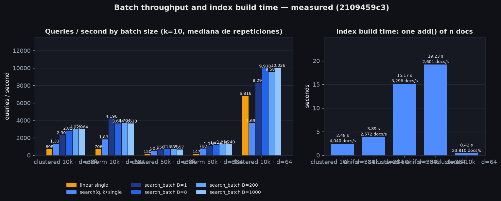
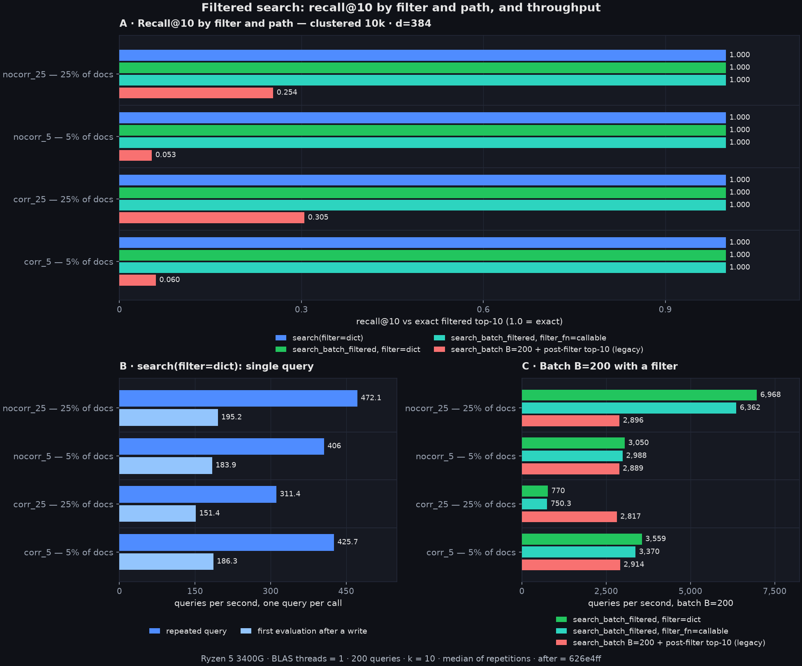

# Performance

This page explains **what** determines the speed and recall of M2M and **how** to
measure it. The figures are read from `benchmarks/results/*.json` (3 significant figures)
and come from the protocol of [`BENCHMARKS.md`](BENCHMARKS.md): synthetic L2-normalised
`float32` data with fixed seeds, 200 queries, `k = 10`, exact ground truth in `float64`,
one BLAS thread, on an AMD Ryzen 5 3400G under WSL2.

## Headline numbers

| Measurement | Data | Result |
|---|---|---|
| `search(q, k)` against a NumPy linear scan, single query | clustered 10k × 384 | 1,300 against 656 QPS: 1.99× |
| `search(q, k)` against a NumPy linear scan, single query | clustered 50k × 384 | 511 against 151 QPS: 3.39× |
| `search_batch`, B = 200, against `Q @ X.T` | clustered 10k × 384 | 1,770 against 4,650 QPS, recall 1.0 for both: the scan is 2.62× faster |
| `search_batch`, B = 200, against `Q @ X.T` | clustered 50k × 384 | 691 against 862 QPS: the scan is 1.25× faster |
| `search(q, k)` against a NumPy linear scan, single query | clustered 10k × 64 | 3,350 against 5,220 QPS: the scan is 1.56× faster |
| recall@10 of the approximate path, default `n_probe` | uniform 10k / 50k × 384 | 0.149 / 0.093 |
| filtered search, recall@10 (4 filters) | clustered 10k × 384 | 1.0 with `search(filter=)`, `search_batch_filtered(filter=)`, `filter_fn=`; 0.053–0.305 when post-filtering |
| `HNSWIndex` / `CrossPolytopeLSH` against a linear scan | clustered 2.5k × 384 | 302 / 123 against 18,000 QPS |

The complete tables, the per-filter throughput and the protocol are in
[`BENCHMARKS.md`](BENCHMARKS.md).

## What you are measuring

- **`search()`** routes the query to `n_probe` coarse clusters (HRM2), scores the
  splats in them and returns the top-k. With `n <= 3000` the batch path degenerates
  to an exact scan, which is also fast. Recall is therefore the recall of an IVF
  index with that `n_probe`: it rises with `n_probe` and falls with `k`. With the
  default it is 1.0 on the clustered benchmark data (10k and 50k × 384) and 0.149 /
  0.093 on uniform data.
- **`search_batch()`** scores each query against the rows of **its own** probed
  clusters (not the union of the batch, as versions before 2.4.0 did by accident).
  On **clustered** data the batch and the single-query path agree. On **uniform**
  data (random vectors) the batch recall equals the single-query IVF recall, which
  is low with the default `n_probe`; it is not `1.0`. A benchmark on uniform data
  measures `n_probe`, not the kernel.
- **Filters** (`search(filter=...)`, `search_batch_filtered(filter=...)`) are
  applied before the top-k, with per-query probe expansion when too few allowed
  documents are found. The filter mask is cached per metadata version, so the
  second query with the same filter costs a cache hit; the first evaluation after a
  write is `O(n)` in Python. With a filter the result is **exact** in IVF mode: a
  cluster is skipped only when the bound `(dist(q, c) - r_c)**2 >= d2_k` proves it
  cannot hold a top-k document [P17]. Recall@10 is 1.0 on the four benchmark
  filters, against 0.053–0.305 for post-filtering an unfiltered top-k
  (`tests/test_p17_exact_filter.py`). Throughput depends on the filter: the bound lets
  the exact path skip whole clusters, so three of the four filters run faster than the
  unfiltered batch at B = 200 on 10k × 384 — 6,970 QPS (`nocorr_25`: 25 % of the
  documents, filter not aligned with the clusters), 3,050 (`nocorr_5`: 5 %) and 3,560
  (`corr_5`: 5 %, aligned), against 1,770 QPS unfiltered. The slow one is `corr_25`
  (25 %, aligned with the clusters): 770 QPS. The per-filter table is in [`BENCHMARKS.md`](BENCHMARKS.md).

  
- **`add()`** appends splats and attaches them to the existing index; the IVF index
  is retrained only after substantial growth. `delete(hard=True)` compacts and
  rebuilds the index (`O(n)` per call); soft deletes do not.

## Knobs

| Knob | Where | Effect |
|---|---|---|
| `n_probe` | `SimpleVectorDB(n_probe=...)`, `HRM2Config` | More probes: higher recall, proportionally more work. The main knob. |
| `adaptive_probing` | `HRM2Config` | Adds probes for a query whose first probes yield too few candidates. |
| `lod` | `HRM2Engine.query(q, k, lod=...)` | `0` and `1` scan less and return the nearest splats of what they probed; recall is lower than `lod=2`. |
| `k_selection="auto"`, `gate_enabled=True` | `SimpleVectorDB` | Chooses the number of coarse clusters with the gate of modulus instead of a fixed `n_coarse`. |
| `enable_lsh_fallback` | `SimpleVectorDB` | Cross-Polytope LSH for data without clusters. Experimental: it is parity-tested against an exact scan, not tuned for throughput. At N = 2500 it runs 123 QPS against 18,000 for a linear scan, and its constructor warns that the mode is experimental. |
| `HNSWIndex` | `m2m.hnsw_index` | Pure-Python HNSW. Experimental; defaults may change. At N = 2500 it runs 302 QPS against 18,000 for a linear scan, with a 43.3 s build. On uniform data its recall is low (0.265 at `ef_search=32`, 0.417 at `ef_search=64`, mean of 5 level seeds), and the paper's level multiplier (`1/ln(M)`) costs about 0.8 recall@10 points against the previous denser hierarchy (0.274 / 0.425) — a cost, not a gain. |
| `SQ8DiskStore(spectral_r=...)` | `m2m.sq8_disk` | Smaller codes (less RAM) in exchange for more rescoring per query. Not a speed-up. |

## Data distribution matters

HRM2 assumes the data has clusters. On embeddings from real text this holds; on
isotropic random data (`np.random.randn`) KMeans finds no structure, the routing
degenerates towards a scan, and the energy of every result is the OOD cap. Use
clustered data or real embeddings to evaluate the engine, and say which one you
used when you report a number.

Measured: recall@10 of `search()` and `search_batch()` on uniform data is 0.149 at 10k
and 0.093 at 50k (384 dimensions) with the default `n_probe`. **There is no `exact=True`
or linear-scan switch on the unfiltered path.** What gives exact results:

| Option | How | `search(q, k)` QPS | `search_batch` B = 200 QPS | recall@10 |
|---|---|---|---|---|
| Small index | `n <= 3000`: every row is scored, there is no pruning | — | — | — |
| All clusters | `SimpleVectorDB(n_probe=100)`: 100 is the number of coarse clusters the index builds on this dataset (read from the engine, not assumed; the default is `n_probe = 5`); larger values are capped | 131 | 160 | 1.000 |
| Any filter | `search(q, k, filter=...)` / `search_batch_filtered(..., filter=...)` take the exact path of P17, also with a filter that accepts everything | 80.9 | 163 | 1.000 |
| NumPy linear scan | reference | 632 | 4,580 | 1.000 |
| Default `n_probe` | for comparison | 1,700 | 3,520 | 0.149 |

Measured on uniform 10k × 384 with the same protocol by `bench/bench_exact_uniform.py`
(`benchmarks/results/bench_exact_uniform.json`, 200 queries; the cluster count is in
`variantes`). The exact options cost 4.83× (all clusters) and 7.81× (any filter) against
the linear scan on a single query, and 28.7× and 28.1× at B = 200. The scan is exact
*and* faster: on data without clusters, scan with NumPy.

## Batching

`search_batch(Q)` amortizes the per-query Python overhead **of the library**: on clustered
10k × 384 it runs 2,190 QPS at B = 1, 2,600 at B = 8 and 1,770 at B = 200, against
1,300 QPS for `search()` one query at a time. It does not beat a plain NumPy scan:
`Q @ X.T` plus a top-10 runs 4,650 QPS at 10k and 862 at 50k with recall 1.0,
as fast or faster than `search_batch` at B = 200
(2.62× at 10k, 1.25× at 50k). The value of the library
in batches is not raw throughput: it is what comes with each hit (`alpha`, energy and
confidence), filters evaluated before the top-k and the splat model. For a single query
`search()` is the right call. Keep `B * n` (distances block) within memory: the SQ8 path
chunks its work so that the block stays below 64 MiB.

## Writes with `storage_path`

Every `add()` on a database with `storage_path` writes the shards and the metadata store:
one document costs 85.8 ms (p95 270) against 0.176 ms in memory,
486× more. Add documents in batches — 1000 documents in one call take
346 ms with storage against 110 ms without (3.15×).
Reopening a saved database costs 2.58 s at 10k and 18.2 s at 50k
(`save(path)` + reopen, 384 dimensions; `benchmarks/results/bench_storage.json`).

## GPU backends

`device="cuda"` needs the `embeddings` extra (`torch`); `device="vulkan"` needs the
`vulkan` extra plus the `glslc` shader compiler from the Vulkan SDK at run time.
When a backend is missing the engine falls back to CPU and says so:
`db.engine.backend` and `db.engine.get_backend_info()` report what is actually
running. GPU execution is not exercised in CI (no GPU on the runners).

## Measuring

- Pin BLAS threads (`OPENBLAS_NUM_THREADS=1 OMP_NUM_THREADS=1`) on small
  matrices: with the default thread count, small operations spin-wait and run
  several times slower.
- Fix seeds, compute exact ground truth in `float64`, report recall and QPS
  together, and state the hardware and the load.
- The tables of [`BENCHMARKS.md`](BENCHMARKS.md) come from `bench/bench_search.py`,
  `bench/bench_filtered.py`, `bench/bench_index_types.py` and `bench/bench_storage.py`, all
  on the shared `bench/_protocol.py`; the rows live in `benchmarks/results/*.json`
  (`before_a74d9e4/` holds the run on the commit before the audit). The exact-options table
  above comes from `bench/bench_exact_uniform.py`, the run-to-run noise from
  `bench/bench_noise.py` (which compares two archived search tables) and the learning / SOC
  figures of the README from `bench/bench_learning_soc.py`. `benchmarks/bench_lsh.py`
  is the weekly LSH measurement; the `bench/history/*.json` files are historical.

## Noise between runs

`bench/bench_noise.py` compares, row by row (same dataset and `parametro`), the two archived
runs of the search table: `benchmarks/results/bench_search_run1_2109459.json` (measurement
commit 2109459) and `bench_search.json` (measurement commit 626e4ff), which behave the same
on the measured paths. The result is `benchmarks/results/bench_noise.json`. Of 45 rows, 36
stay within ±10 % of QPS (median |Δ| 4.06 %, p90 16.0 %); the largest gap is 42.1 %, in
`search_batch` at B = 200 on clustered 10k × 384 (3,060 against 1,770 QPS, same recall).
The other rows outside the band are the batched linear scan at B = 1000 on 50k × 384
(clustered −39.0 %, uniform −32.4 %), the single-query linear scan on clustered 10k × 64
(−23.4 %), `search_batch` at B = 1000 on clustered 10k × 384 (−16.0 %), uniform 50k × 384
(−16.0 %) and clustered 10k × 64 (−12.0 %), `search_batch` at B = 1 on clustered 10k × 64
(+12.0 %) and `search_batch` at B = 200 on uniform 50k × 384 (−10.1 %). Recall@10 was
identical in all 45 rows. Read differences below ~10 % — and larger ones for big batches and
for the linear baselines, up to 42 % — as noise of this host unless they reproduce.
